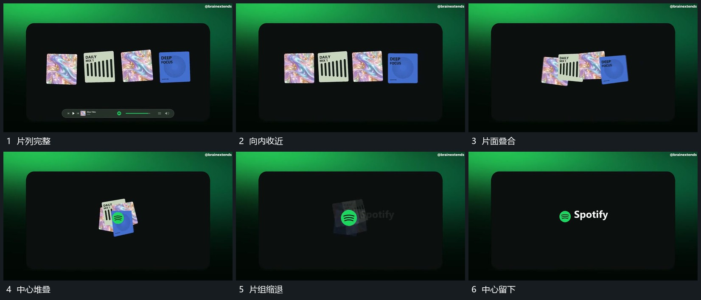

# 多片向中央收拢叠合并缩小留下中心小形

## 运动指令

让横向片列向中央收近，越靠近中心越增加交叠与少量倾角，形成紧凑堆叠。堆叠整体缩小，片面逐步退去，原中央小形在其后方露出并保留，作为下一短行起点。

## 视频切片

[播放本机制的原片切片](m04.mp4)

覆盖分镜中“片列完整”至“中心留下”的连续过程，并保留邻近的前后衔接画面；原片中交叠发生的动作一并保留。

## 分镜过程

## 组合与调整

收拢时保持前后次序，中心小形在片组后方有来源；不要用全体淡出替代收拢。
