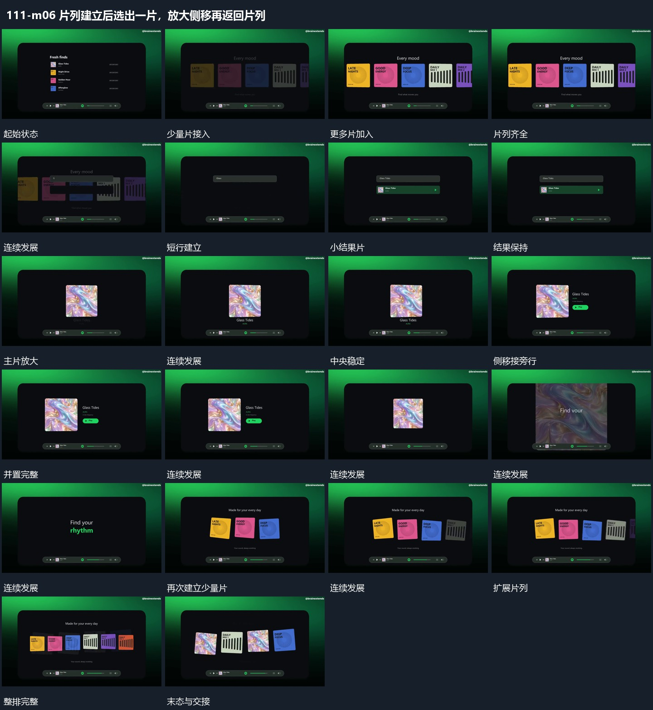

# 片列建立后选出一片，放大侧移再返回片列

## 运动指令

起始：已有几片并置。

1. 多片横向错峰加入并穿插列表建立。

2. 选中小片放大到中心，随后侧移为旁字让位，再换回多片横向排列。

上述镜头变化与局部动作按同一条连续过程推进；写明同时发生的步骤在原场面中交叠，不先完成整段运镜再重演局部。

## 视频切片

[播放本机制的原片切片](m06.mp4)

保留起始准备、连续发展和完成或明确交接；首尾按本段运动范围裁切，不拼接、不变速。相连的小动作合为同一完整段落。

## 分镜过程

## 组合与调整

保留以下动作关系：多片横向错峰加入并穿插列表建立；选中小片放大到中心，随后侧移为旁字让位，再换回多片横向排列。

可调整位移距离、层级间距、重复数量与相对快慢；已有锚点和未退出的层继续承接。连接下一段时以切片末态为起点，另行设计不连续的状态转换。
