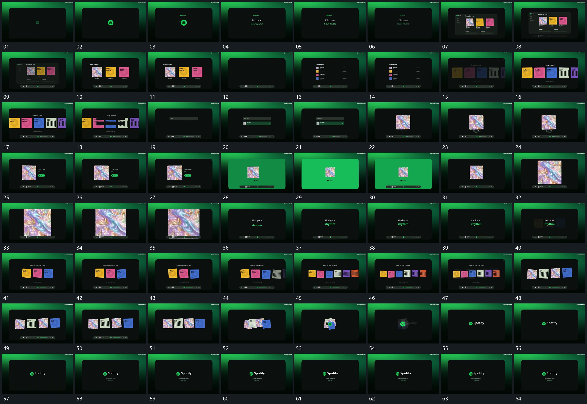

# 111｜原片运动总览

[观看完整原片](video.mp4)

## 运动总览

全片先在外框内建立小中心与字行，再用内框退去原片面放大接管底条保留减去内框，保留其中片面并放大接管。多片沿横向错开加入形成连续片列让多片沿横向错开增加，底部细条作为持续参照。中段从小结果片放大到中央再侧移加入旁行从短行与小结果片中提取一片，放大到中央，再侧移并加入旁行。

中央片继续放大后退去，多片沿横向错开加入形成连续片列再次展开集合。结尾多片向中央收拢叠合并缩小留下中心小形将多片向中央收拢成带转角的堆叠，逐步缩小并退去，中心小形留下；中心小形保持旁行下行逐次建立在其旁侧及下方补短行，完成收尾。

## 完整运动段落

以下按原片中的出现顺序引用。建立、内部发展及完成反馈放在同一段中；同时发生的局部动作与运镜写在同一份指令里。不同段之间可以是连续接管，也可以是直接切换，不能仅凭条目相邻认定可直接拼接。重复出现的同类运动采用一次连续代表范围，切片不以逐段无缝覆盖整片为目标。

1. [内框退去原片面放大接管底条保留](mechanisms/m01.md)：释放内框放大原内容

2. [片列建立后选出一片，放大侧移再返回片列](mechanisms/m06.md)：多片横向错峰加入并穿插列表建立；选中小片放大到中心，随后侧移为旁字让位，再换回多片横向排列。

3. [多片向中心收拢叠合，缩成小形后补齐结尾字行](mechanisms/m07.md)：多片向共同中心收拢叠合，整体缩小留下中央小形；旁字与下行逐次建立，最后共同保持。

切片保留起始准备、必要内部停顿和完成或明确交接；首尾省略无新发展的等待，持续运动不要求人为停住。以上基于真实源帧序列和重点边界核对，不等同于全片连续声画审片。

## 完整64宫格

