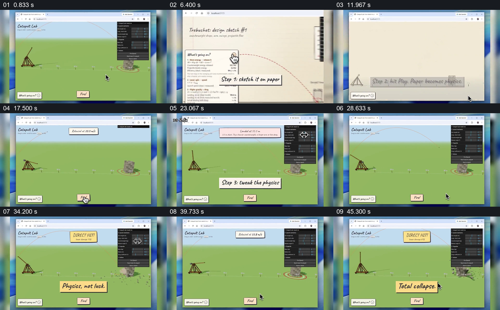

# 先展示命中，再倒回草图和两次试射

- 作品：案例 040《投石机模拟的试验与调整》（索引名称）。
- 原片范围：00:00.000–00:50.000，含起点、不含终点；[完整原片](../video.mp4)｜[本卡片段](c01.mp4)。
- 观察方式：依据整片 64 宫格和约每秒一次的真实源帧观察，未连续原速观看或听审；声音、语气与完整播放节奏未确认。

## 原画面具体怎样设计

浏览器中的投石机命中目标，字幕问“How did we get here?”；画面回到纸面草图，显示抛物线、目标和参数。点击播放后草图变成绿色场地中的模拟，第一次发射结果提示偏短；右侧参数面板被调整，第二次发射出现“DIRECT HIT!”。随后再调整并发射，目标结构坍塌。

## 为什么这样设计，好在哪里

先看到结果再回溯操作，给试验过程一个明确目标；第一次偏差与后续参数面板使第二次命中有可观察的前后关系。画面本身不能证明模拟与现实物理一致或特定参数是唯一原因。

以上为依据画面的分析，非作者自述；预期观看效果未经观众测试。

## 可直接使用的创意指令

当讲述一次真实试验时，保留目标、预测方式、首次结果与测得偏差；展示实际改变的参数及再次试验结果，让结果和改动对应。模拟应标明假设与适用范围，不能用示意命中替代真实实验验证。
