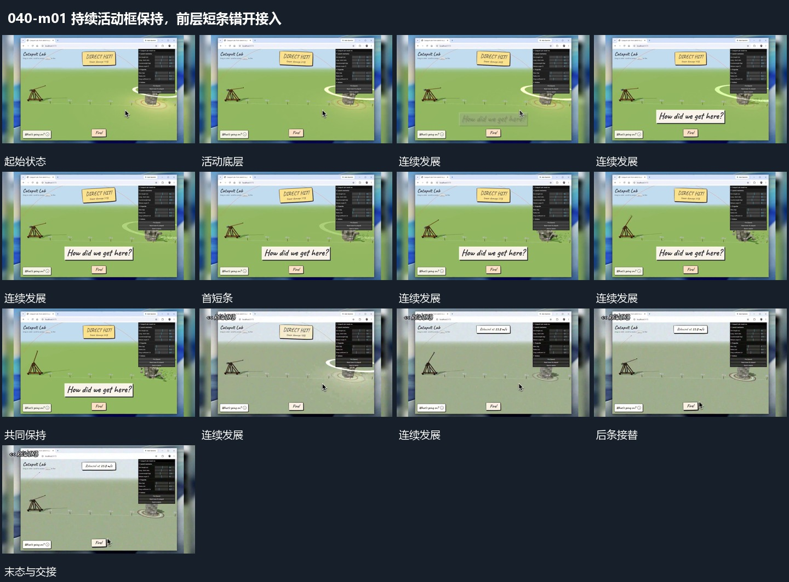

# 持续活动框保持，前层短条错开接入

## 运动指令

保留大框中的连续活动，在前层接入短说明条。说明条落稳后底层继续活动，随后用新的短条接替，条的位置服务当前局部但不带动整框重排。

## 视频切片

[播放本机制的原片切片](m01.mp4)

保留起始准备、连续发展和完成或明确交接；首尾按本段运动范围裁切，不拼接、不变速。尾部只保留理解结果所需的展示。

## 分镜过程

## 组合与调整

可应用于任何真实活动材料。只描述覆盖与接续，不把素材内部画面当作可直接控制的代码对象。
