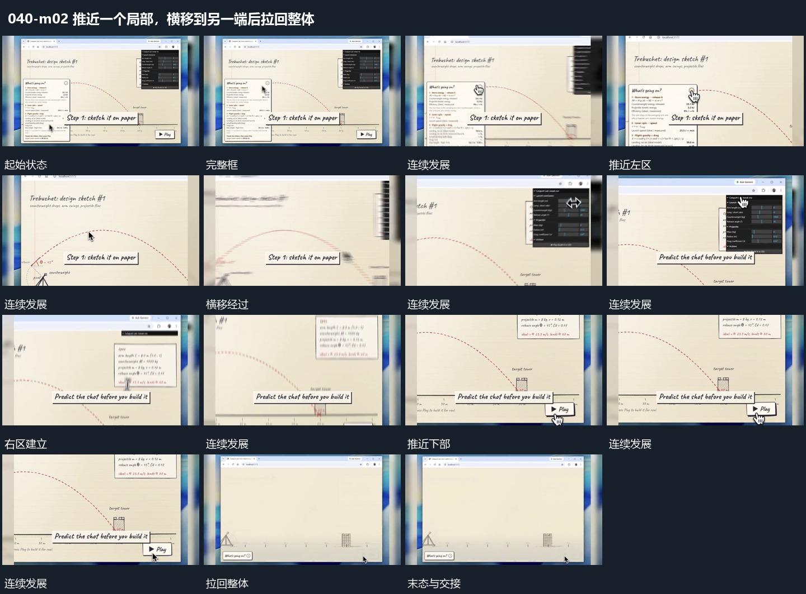

# 推近一个局部，横移到另一端后拉回整体

## 运动指令

从完整框推近一个局部，再沿横向移动到另一端，接着聚焦其下部区域；观察结束后拉回全框。底层材料在运镜期间保持连续，前层短条可以随观察区域接替。

## 视频切片

[播放本机制的原片切片](m02.mp4)

保留起始准备、连续发展和完成或明确交接；首尾按本段运动范围裁切，不拼接、不变速。尾部只保留理解结果所需的展示。

## 分镜过程

## 组合与调整

以素材有效区域决定推近幅度，避免放大到关键部分越界。镜头应有明确落点而非持续无目标漂移。
