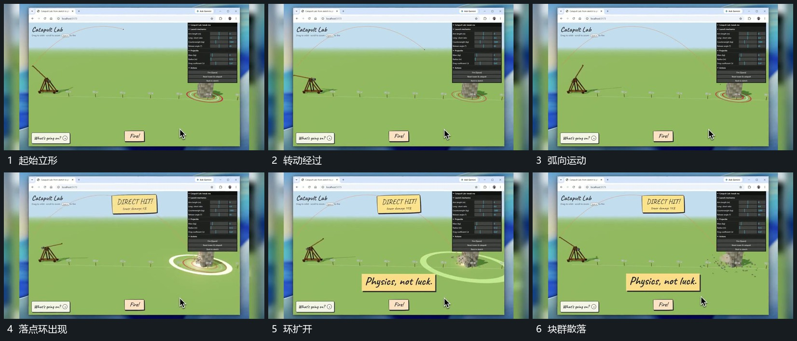

# 局部转动接到弧向穿越，落点环扩开后块群散落

## 运动指令

让局部杆形绕一端转动，接续一个小形沿弧向穿越固定空间。小形到达另一侧后接入扩散圈，原有堆积块群向周边散落；短反馈片在落点动作已发生后接上。

## 视频切片

[播放本机制的原片切片](m03.mp4)

覆盖分镜中“起始立形”至“块群散落”的连续过程，并保留邻近的前后衔接画面；原片中交叠发生的动作一并保留。

## 分镜过程

## 组合与调整

这里描述原片内部可见动作，不推定真实物理参数。新片可简化成几何运动，保持转动、穿越、落点反馈的因果顺序。
