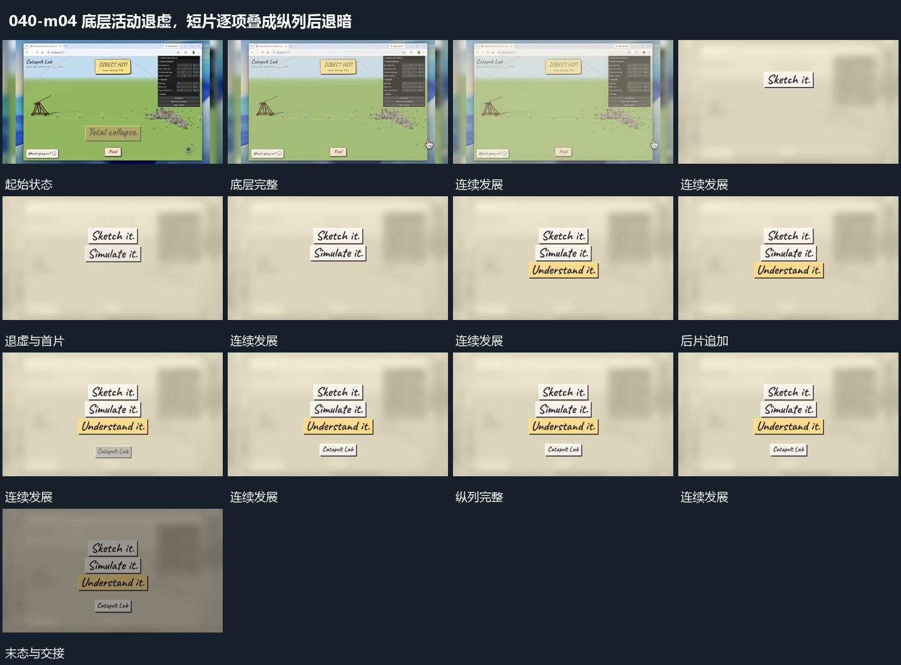

# 底层活动退虚，短片逐项叠成纵列后退暗

## 运动指令

让完整活动框退虚，保留为后层。中央先接入首短片，再向下逐项追加短片，片与片略错开位置；末条补齐后整列保持，再共同退暗。

## 视频切片

[播放本机制的原片切片](m04.mp4)

覆盖分镜中“底层完整”至“共同退暗”的连续过程，并保留邻近的前后衔接画面；原片中交叠发生的动作一并保留。

## 分镜过程

## 组合与调整

结尾不需要原主题文字，保留底层与前层的接续即可。
