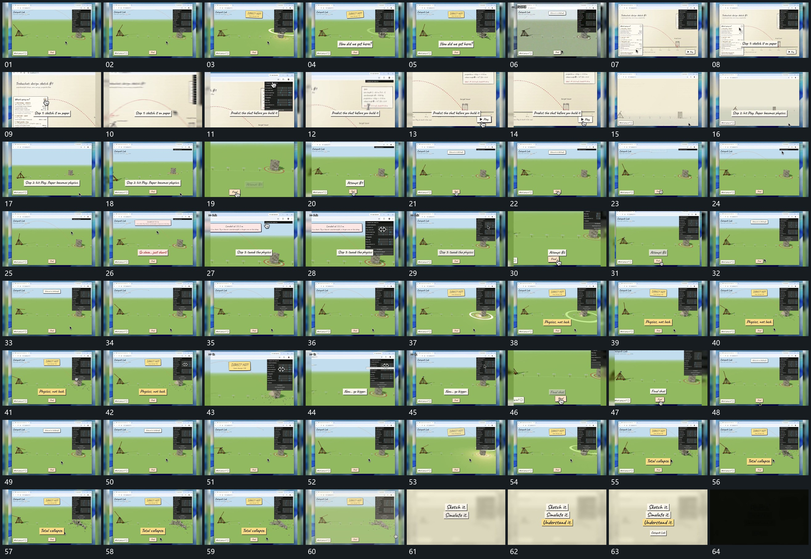

# 040｜原片运动总览

[观看完整原片](video.mp4)

## 运动总览

全片以持续活动的固定大框为底层。开头局部点沿弧线经过，落点圈扩散，短标签接入。持续活动框保持，前层短条错开接入 在保留活动框时接入前层说明条，再用 推近一个局部，横移到另一端后拉回整体 推近局部、横移到另一端，拉回整体。

中段反复沿用 推近一个局部，横移到另一端后拉回整体 聚焦侧边与下部，再回到完整框。局部转动接到弧向穿越，落点环扩开后块群散落 从局部转动接到弧向穿越，落点环扩开，块群散落，前层标签继续更新。末段块群运动结束后 底层活动退虚，短片逐项叠成纵列后退暗 让底层退虚，中央短片依次叠成纵列，补入末条，最后退暗。

## 完整运动段落

以下按原片中的出现顺序引用。建立、内部发展及完成反馈放在同一段中；同时发生的局部动作与运镜写在同一份指令里。不同段之间可以是连续接管，也可以是直接切换，不能仅凭条目相邻认定可直接拼接。重复出现的同类运动采用一次连续代表范围，切片不以逐段无缝覆盖整片为目标。

1. [持续活动框保持，前层短条错开接入](mechanisms/m01.md)：后层不停，前条落稳

2. [推近一个局部，横移到另一端后拉回整体](mechanisms/m02.md)：推近与横移衔接，底层活动保持

3. [局部转动接到弧向穿越，落点环扩开后块群散落](mechanisms/m03.md)：转动先触发，轨迹与反馈随后接上

4. [底层活动退虚，短片逐项叠成纵列后退暗](mechanisms/m04.md)：先退虚底层，再累积前片

切片保留起始准备、必要内部停顿和完成或明确交接；首尾省略无新发展的等待，持续运动不要求人为停住。以上基于真实源帧序列和重点边界核对，不等同于全片连续声画审片。

## 完整64宫格

