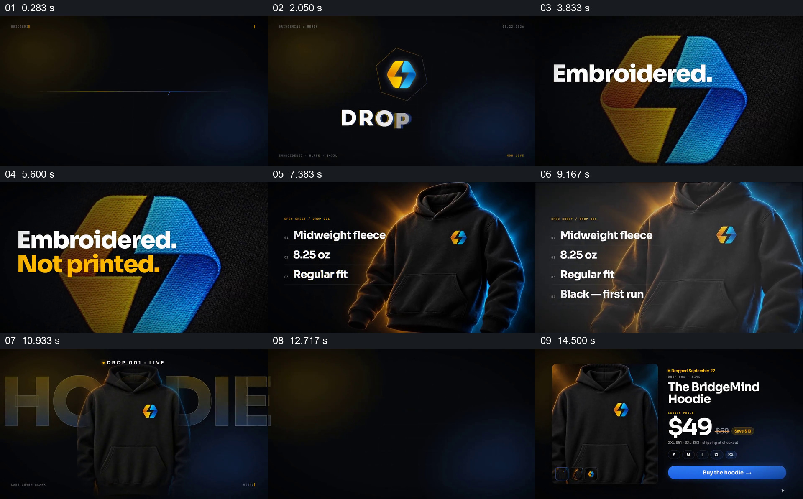

# 从品牌标记与工艺局部走到整件商品和购买界面

- 作品：案例 020《服装影像与产品文字》（库内索引名）。
- 原片范围：00:00.000–00:16.000，含起点、不含终点；[完整原片](../video.mp4)｜[本卡片段](c01.mp4)，片段起点对应原片 0.000 秒。
- 范围依据：从深色画面中的品牌图形建立开始，到商品页呈现名称、价格、尺码与购买按钮为止；后续切入配送问题，是另一项独立表达。
- 观察方式：核看原片 64 帧总览、各卡九宫格，另核看 0–5 秒和 15–26 秒约每 0.25 秒的源帧；未独立连续原速观看，快速变化和运动节奏待核；未独立听审，声音内容未知。片中事实与宣传未独立查证，新题材迁移尚未实测。

## 原画面具体怎样设计

深色底上先有细线和轮廓，黄、蓝两块图形靠近后形成品牌标记，下方建立 “DROP 001”。接着观众看到占据大半画面的同一标记刺绣质感特写，白色 “Embroidered.” 叠在图案前方，黄色 “Not printed.” 随后补成对照。

然后画面回到带同一标记的黑色连帽衫：衣服位于右侧，左侧依次排列面料、重量、版型与颜色等项目；黄蓝边光把黑衣从深色底上分离。接下来的状态把衣服放到中央，巨大的 “HOODIE” 藏在衣服后面。再转到类似商品详情页的布局：左边是衣服与缩略图，右边组合商品名、价格、尺码选项和蓝色购买按钮。片中价格从 $59 显示为 $49，均为画面信息，不代表经核实的实际售价。

## 为什么这样设计，好在哪里

中心标记在开头、刺绣细节和整件衣服上反复可认，使观察距离从图形转到织物、再回到全貌时仍有参照；“Embroidered / Not printed” 直接压在能看到纹理的局部上，文字所指有画面承载。左列规格与右侧商品同时存在，读信息时仍知道这些信息属于哪件衣服。最后将商品和决策控件放到一页，完成从识别到了解，再到购买入口的观看路径。

如果只保留泛泛的服装图，难以支撑特写承担的工艺说明；如果规格和商品不同时出现，后半段的对应关系会减弱。蓝黄光与具体字体是本片形式，商品身份跨画面可辨及细节、整体、信息之间的对应关系更关键。这是基于画面的分析，非作者自述，也未做观众测试。

## 可直接使用的创意指令

适合介绍具有可辨工艺或局部特点的具体商品：准备能够清楚显示同一商品局部、整体和必要规格的材料，先建立一个以后仍能辨认的标识或形态，再让局部占据足够画面，并把一句可核实的特点放在读者能同时看到细节的位置。回到全貌后，将少量与决策有关的规格置于商品旁，保持商品本身可见；需要购买引导时，再把名称、真实价格、选择项与同一商品合成清楚的界面。画幅、色彩、是否出现品牌动画与具体转场可以按项目调整，但细节必须与所展示的商品版本一致；缺少清楚的工艺影像或无法核实信息时，不用漂亮的局部替代证据。
