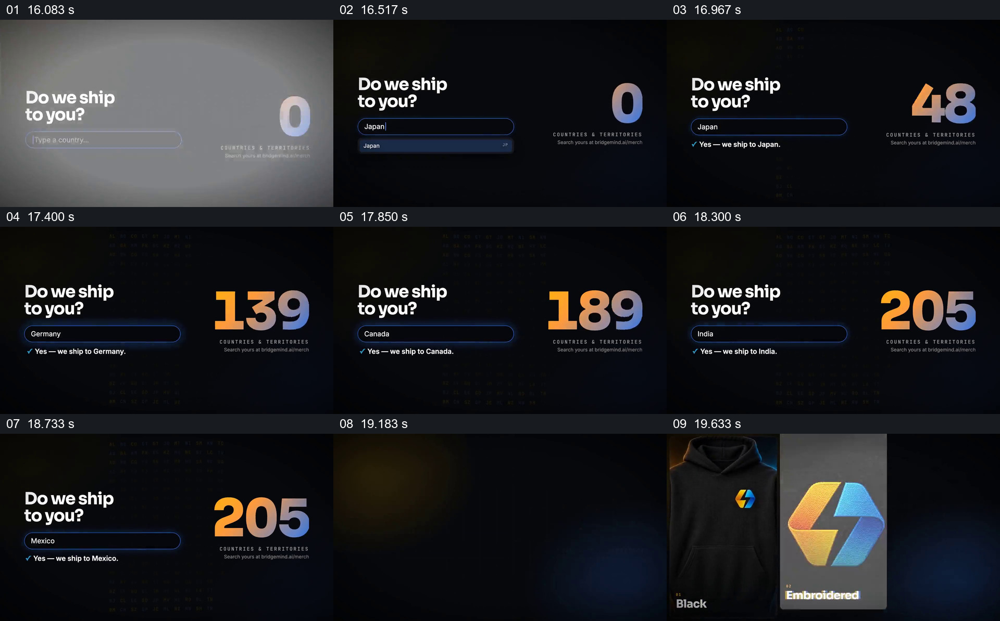

# 用不同目的地查询回应配送问题

- 作品：案例 020《服装影像与产品文字》（索引名称）。
- 原片范围：00:16.000–00:20.000，含起点、不含终点；[完整原片](../video.mp4)｜[本卡片段](c02.mp4)。
- 观察方式：依据整片 64 宫格和约每秒一次的真实源帧观察，未连续原速观看或听审；声音、语气与完整播放节奏未确认。

## 原画面具体怎样设计

深色画面左侧写“Do we ship to you?”，下方输入框依次显示日本、澳大利亚和尼日利亚，旁边均显示肯定式配送提示；右侧大数字随画面变化，最后出现“205”。

## 为什么这样设计，好在哪里

固定问题和回答位置，使地区变化成为可直接比较的变量；大数字提供另一层规模提示。片中未给出数字统计口径，也未核实每个地区的实际配送条件。

以上为依据画面的分析，非作者自述；预期观看效果未经观众测试。

## 可直接使用的创意指令

当用户需要判断某项服务是否覆盖自己的地区时，先固定清楚的问题和输入位置，选择几个有代表性的真实地区，逐一展示经过核实的可用结果及必要限制；若同时给出覆盖规模，应注明统计口径和更新时间。示意查询不代表真实订单或配送承诺。
