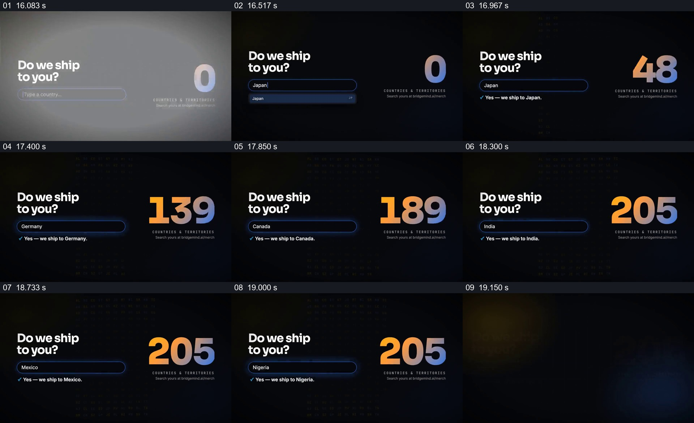

# 让不同目的地在同一查询位置轮流得到回答

- 作品：案例 020《服装影像与产品文字》（库内索引名）。
- 原片范围：00:16.000–00:19.200，含起点、不含终点；[完整原片](../video.mp4)｜[本卡片段](c02-20261111.mp4)，片段起点对应原片 16.000 秒。
- 范围依据：从配送查询画面建立到多个地区示例及 205 的结果显示完毕；约 19.2 秒开始切入商品拼组，作为下一张卡的入口。
- 观察方式：核看原片 64 帧总览、各卡九宫格，另核看 0–5 秒和 15–26 秒约每 0.25 秒的源帧；未独立连续原速观看，快速变化和运动节奏待核；未独立听审，声音内容未知。片中事实与宣传未独立查证，新题材迁移尚未实测。

## 原画面具体怎样设计

上一商品页之后，深色背景中左侧显示 “Do we ship to you?”，其下是细蓝边输入框；右侧是很大的渐变数字，下方标注 “COUNTRIES & TERRITORIES”，底部还有提示查询的网址。开始的数字为 0，输入框先出现日本；随后下方显示带蓝色对号的 “Yes — we ship to Japan.”。

后续抽样画面中，输入位置先后出现巴西、德国、英国、加拿大、澳大利亚、印度、韩国、墨西哥和尼日利亚等名称，对应的肯定回答留在同一位置。右侧数字在这些状态中逐渐增加到 205，背景还有很淡的字符矩阵；最后配送查询画面退去，黑色商品竖幅开始进入。数字与各次示例并不等同于一一计数：片中未交代统计口径，也未独立核实覆盖范围或界面是否真的联网查询。

## 为什么这样设计，好在哪里

左侧固定的问题、输入框和答复位置，让每一次更换地区都能被读作同一个问题下的新例子；右边更大尺度的数字提供另一种整体规模的视觉参照。问题与示例并排呈现，观众既能从具体地点理解 “是否送到我这里”，又能看见片中给出的汇总结果。若只留下数字，个体查询的代入感会减弱；若只快速换国家名而没有持续可辨的答案位置，比较关系也会变得含糊。以上是基于抽样画面的设计分析，非实际配送核验或受众测试。

## 可直接使用的创意指令

当内容要回答同一服务在不同地点或不同对象上是否适用，并有可靠逐项数据时，先明确一个观众会问的问题，把对象选择、对应结果和必要条件放在固定且可读的关系中；选取能体现真实差异的几个例子，逐一替换对象及其结果，保留问题和回答位置作为参照。若还有覆盖规模，把经核实的总数与统计范围放在旁边，避免让少量示例被误认为总数的计算过程。输入框形态、色彩和例子数量可随项目更改；地区限制、日期与数据口径须真实，示意界面不能冒充实时查询或对每个地区的承诺。
