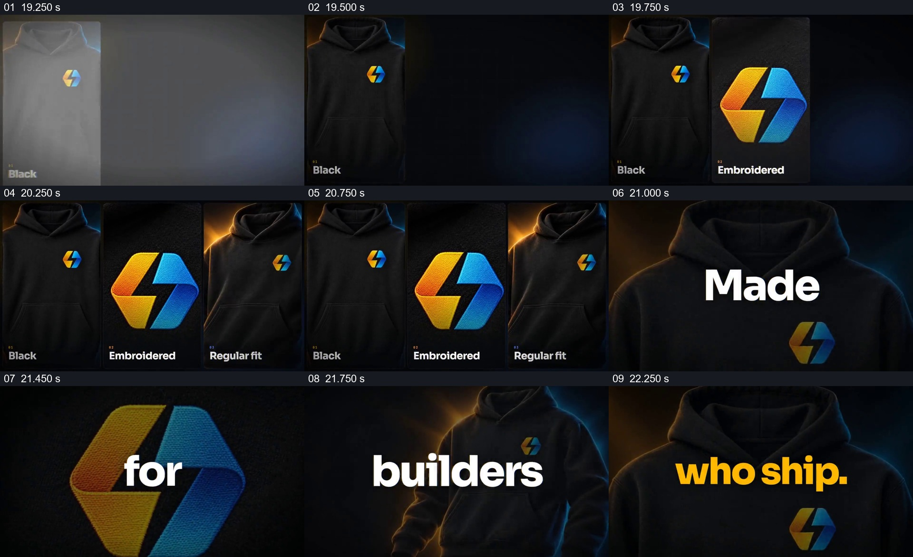

# 先把商品特征拼成一排，再让同一素材接力说出口号

- 作品：案例 020《服装影像与产品文字》（库内索引名）。
- 原片范围：00:19.200–00:22.500，含起点、不含终点；[完整原片](../video.mp4)｜[本卡片段](c03-20261111.mp4)，片段起点对应原片 19.200 秒。
- 范围依据：从配送画面退去、第一块商品竖幅出现前的深色背景开始，到 “who ship.” 在卫衣画面上出现并交给后续品牌公告为止。
- 观察方式：核看原片 64 帧总览、各卡九宫格，另核看 0–5 秒和 15–26 秒约每 0.25 秒的源帧；未独立连续原速观看，快速变化和运动节奏待核；未独立听审，声音内容未知。片中事实与宣传未独立查证，新题材迁移尚未实测。

## 原画面具体怎样设计

深色背景先留下左侧竖幅，画面是黑色卫衣，底部标 “Black”；中间补入放大的黄蓝标记与 “Embroidered”；右侧再加入另一张卫衣视角及 “Regular fit”。已出现的竖幅在后续状态中仍能看见，三块并列占满主要宽度，分别让颜色、图案与衣服形态得到一个独立观察窗口。

三联画之后，画面变成一次只看一个放大的商品画面，文字也分次出现：卫衣上是 “Made”，标记特写上是 “for”，另一视角卫衣上是 “builders”，卫衣前景上再出现黄色 “who ship.”。这些词共同构成片中一句口号，同一件商品及其标记成为跨画面的共同参照。此后画面转入 “Drop 001 is live.” 的品牌公告与商品购买结束页。

## 为什么这样设计，好在哪里

前半段把商品的三种观察目的并列：先看整体颜色，再看工艺标记，再看服装形态；每块画面都有简短标注，观众不必靠一个镜头同时辨认所有细节。后半段改成单幅大画面与一个短词，注意力从并排比较收束到逐次阅读，而前面建立的卫衣与标记仍可识别。拼组和口号分担不同任务，放在一起使特征回顾自然转向品牌主张。

如果三个视角并非同一商品、或口号所用画面与前面完全无关，这种从集合到逐一阅读的连续参照就会减弱；不要求照搬三栏、原词或黄蓝配色。这是对可见画面的分析，观看感受未做受众验证。

## 可直接使用的创意指令

适合一个主体有多个可辨特征，且接下来有一句真正简短、可分组阅读的主张。准备能对应同一主体的整体、关键局部和另一有信息价值的视角；在共同背景上逐项建立各自有明确作用的画面窗口，已出现的窗口保留到集合完整，并用精短文字标明各窗口的观察重点。随后从集合切回同一主体的单幅画面，让主张的各个词组按正确阅读顺序与不同视角对应，最后保留完整语义的收束，再接下一段。窗口数量、具体形状和词组数由素材及语义决定；如果视角无法辨识为同一主体、文字拆开后无法读懂，或实际材料不足以支持特征描述，就重新组织，而不要强套。
