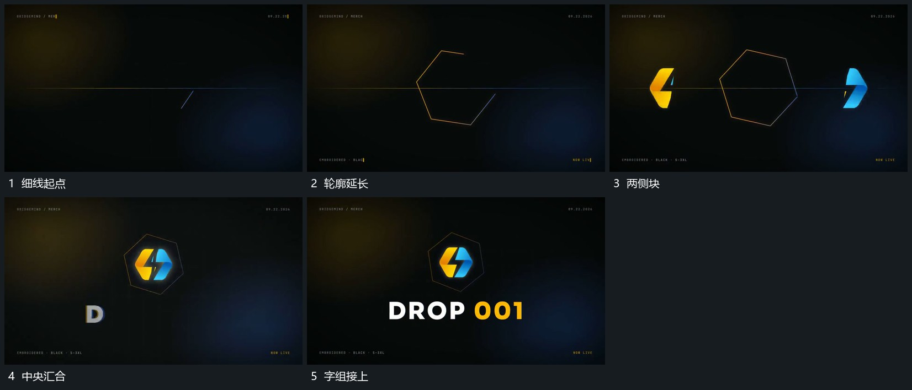

# 线段闭合，两侧块向中央汇合

## 运动指令

让细线逐段延长形成闭合轮廓，两侧独立块向中央靠拢，汇成完整中心形。中心形稳定后下方字组逐项建立。

## 视频切片

[播放本机制的原片切片](m01.mp4)

覆盖分镜中“细线起点”至“字组接上”的连续过程，并保留邻近的前后衔接画面；原片中交叠发生的动作一并保留。

## 分镜过程

## 组合与调整

可改轮廓，不指定隐藏折叠结构；保留先围范围再汇合。
