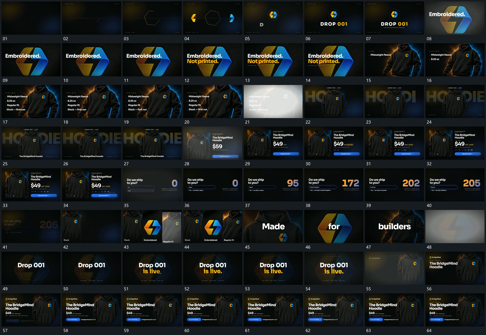

# 020｜原片运动总览

[观看完整原片](video.mp4)

## 运动总览

片头 线段闭合，两侧块向中央汇合 由线段逐步组成闭合轮廓，两侧块汇向中央，字组随后建立。接 中心标记推近占满局部，字组在其前方接入 推近中央标记成为全幅局部，上下短句错开显出。

下一组主形保持在一侧，主形固定，旁侧文字逐行累积 在旁侧逐行补齐文字；亮闪后主形回到中央，后层大字接上。随后 主形收进片面，旁字数值与长条错开建立 把主形收进独立片面，旁侧数字、标签和长条逐项建立。数字与点阵累计段复用内部变化，不为每次输入另建卡。

后段 竖片按空位错开补入，形成完整一排 分批补成多片竖向集合，再快速换入主字与局部图像。几次短闪接替后主形再次留场，片尾侧方文字与长条按层接入并保持。

## 完整运动段落

以下按原片中的出现顺序引用。建立、内部发展及完成反馈放在同一段中；同时发生的局部动作与运镜写在同一份指令里。不同段之间可以是连续接管，也可以是直接切换，不能仅凭条目相邻认定可直接拼接。重复出现的同类运动采用一次连续代表范围，切片不以逐段无缝覆盖整片为目标。

1. [线段闭合，两侧块向中央汇合](mechanisms/m01.md)：轮廓先建立，两侧块在内汇合

2. [中心标记推近占满局部，字组在其前方接入](mechanisms/m02.md)：推近改变尺度，文字独立叠入

3. [主形固定，旁侧文字逐行累积](mechanisms/m03.md)：主形留场，行文从上向下补入

4. [主形收进片面，旁字数值与长条错开建立](mechanisms/m04.md)：收小形成来源明确的片面，旁层逐项补入

5. [竖片按空位错开补入，形成完整一排](mechanisms/m05.md)：先到项保持，后项补入剩余位置

切片保留起始准备、必要内部停顿和完成或明确交接；首尾省略无新发展的等待，持续运动不要求人为停住。以上基于真实源帧序列和重点边界核对，不等同于全片连续声画审片。

## 完整64宫格

