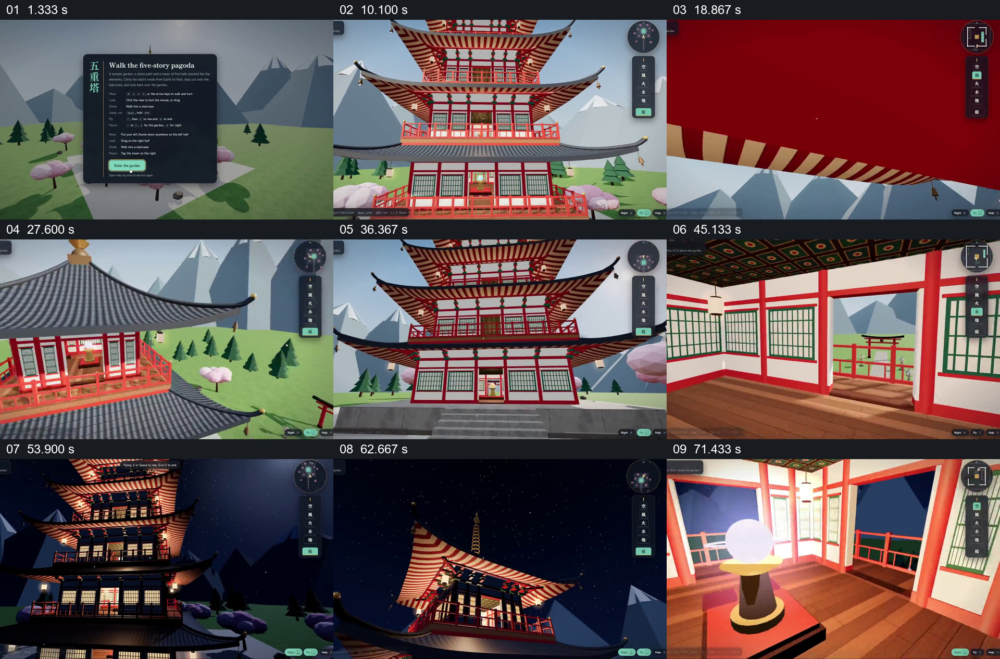

# 从外部进入建筑，再用日夜变化重新观察同一空间

- 作品：案例 096《五重塔虚拟漫游》（本次概括）。
- 原片范围：00:00.000–01:18.848，含起点、不含终点；[完整原片](../video.mp4)｜[本卡片段](../video.mp4)。
- 观察方式：依据约每秒一次的真实源帧观察，未连续原速观看或听审；声音、语气与完整播放节奏未确认。

## 原画面具体怎样设计

开头显示五重塔漫游说明，视点从鸟居沿路径接近塔身，上升并从窗口进入室内，观察楼梯、栏杆及发光球体；随后回到塔外，绕看整座建筑，再次进入。环境转为夜色后，建筑窗户亮起，视点从外部接近顶层，进入发光的室内并走到阳台望向山景。画面边缘始终保留操作界面。

## 为什么这样设计，好在哪里

外部路径和楼层内部的往返，使高塔的位置、入口与内部空间有连续参照；夜间重新访问相同建筑则突出光照改变后的空间感。视频是界面演示，具体交互能力需单独核验。

以上为依据画面的分析，非作者自述；预期观看效果未经观众测试。

## 可直接使用的创意指令

展示可探索建筑时，先让入口和整体轮廓可辨，沿可追踪的路径进入，再从内部回望外部参照；若要比较光照，保留同一空间并让光源和视野变化可见。镜头路径和交互提示依据实际演示录制。
