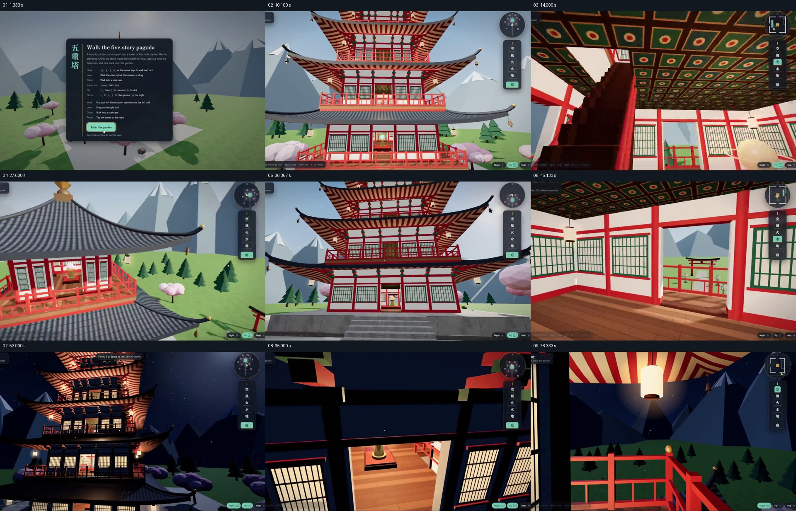

# 从外部入口走进建筑，再以夜景回看同一空间

- 作品：案例 096。
- 原片范围：00:00.000–01:18.848（源时间，含起点、不含终点）；[完整原片](../video.mp4)｜[本卡片段](../video.mp4)。范围与既有片段一致，复用原片，另从原片补制覆盖尾段结果的分镜。原片视频画面到约 01:18.733，音频保留至约 01:18.848；复用原片时保留这段声音尾部。
- 观察方式与未确认范围：核看全片 64 帧总览和本卡九宫格；未独立连续原速观看或听审，抽帧间运动、精确节奏、声音和同步未确认。价值判断为作品分析，跨项目迁移尚未实测。

## 原画面具体怎样设计

片头是带使用说明的深色面板，后面能看到绿色庭院、山形和五层塔。面板消失后，石径从画面下方通向红白色的塔，门廊、粉色树木和远山为塔提供空间尺度；右侧一直保留一列小控制图标。

随后一连串画面从道路到塔身外立面，再到廊栏、门窗与室内：红柱、白墙、木地板和带图案的顶棚围成同一套空间，发光球体及楼梯给室内提供可辨参照。接着视点出现在塔外高处，能再次看见层层屋檐与周围树木，随后回到正面并重新进入楼层，从室内的栏杆望向鸟居、路径和远山。

后半段在同一庭院和塔的形态中出现夜景：远山变暗、塔窗及廊灯发亮，外部远景转到靠近高层窗口的观察，室内仍可见球体、楼梯及木地板，最后视线留在阳台与夜色庭院之间。帧序列支持位置与昼夜状态的变化，不能独立确认完整行走轨迹、过渡速度或操作过程。

## 为什么这样设计，好在哪里

先让石径与整塔构成“在哪里”的关系，再让门窗、楼梯和室内球体给出“走到了哪里”的线索。一次回到塔外的高视角让观众重新认出各层与庭院，之后再进入，内部不至于变成无法定位的独立房间。

夜间版本重复塔形、亮窗和庭院参照，使变化主要集中在照明与空间气氛；右侧控制项提醒观众这是软件演示。以上是对画面组织的分析，不代表已验证交互功能。

## 可直接使用的创意指令

需要展示可进入的空间时，准备可辨的外观、入口路径、内部通道和至少一个内外共认的标志。先从外围让观众看清目标与入口，再沿门窗、楼梯或走廊进入；参观局部后回到能辨认整体的视角，确认内部与外部的对应，再选择另一个空间状态或时间重访。

可以用实拍、三维、照片或交互录屏，路径和光照按实际材料决定；保留入口、内部和外部之间能被认出的空间关系。若只有单次照明素材，不必伪造昼夜变化，使用同一地点的其他真实对照即可。
