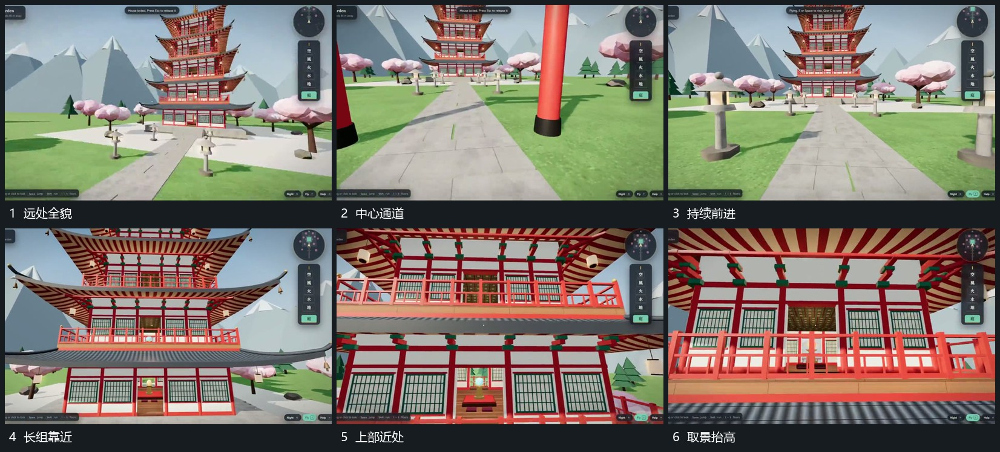

# 沿中心通道推进同时抬高取景

## 运动指令

沿中心通道持续前进，两侧近物向边缘经过，中央长组逐步扩大。靠近时取景逐渐抬高，让其上部边界进入主要范围；通道与中央轴仍保留，结束时对准可进入的局部开口。

## 视频切片

[播放本机制的原片切片](m01.mp4)

覆盖分镜中“远处全貌”至“取景抬高”的连续过程，并保留邻近的前后衔接画面；原片中交叠发生的动作一并保留。

## 分镜过程

## 组合与调整

调整路线可用于任何空间；推近与抬高连续交叠，不先停住再跳到上端。
