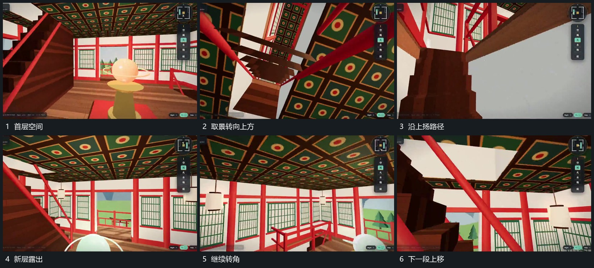

# 沿上扬路径转角穿过框边进入下一层

## 运动指令

从当前空间转向上扬路径，取景随前进向上抬，近侧框边先后越过画面。通过边界后让下一层空间从同一方向露出，侧面开口作为新参照；转角和前进交叠，避免完全退空。

## 视频切片

[播放本机制的原片切片](m02.mp4)

覆盖分镜中“首层空间”至“下一段上移”的连续过程，并保留邻近的前后衔接画面；原片中交叠发生的动作一并保留。

## 分镜过程

## 组合与调整

仅在真实可穿过的边界设计路线；原片局部遮挡不作为新片穿透实体的要求。
