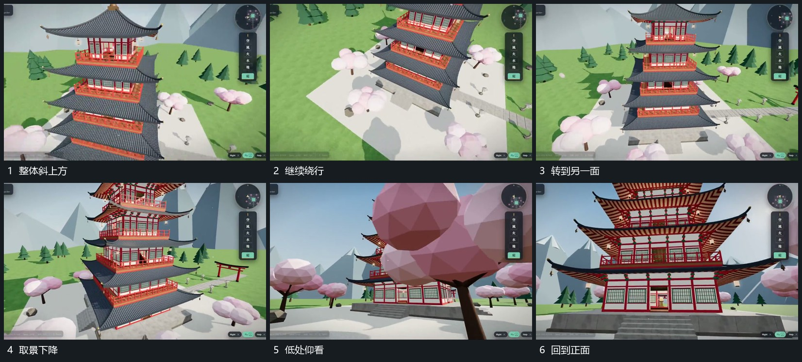

# 围中央长组绕行并连续改变俯仰高度

## 运动指令

保持中央长组可辨，取景沿其外围绕行，同时改变高度，先从侧上方露出上层关系，再逐步下降转为斜下方。近侧遮挡经过幅度较大，中央组不被重新排列。绕行完成后把取景对准原入口。

## 视频切片

[播放本机制的原片切片](m03.mp4)

覆盖分镜中“整体斜上方”至“回到正面”的连续过程，并保留邻近的前后衔接画面；原片中交叠发生的动作一并保留。

## 分镜过程

## 组合与调整

绕行可以只做半程；高度变化有明确去向，避免无目的持续旋转。
