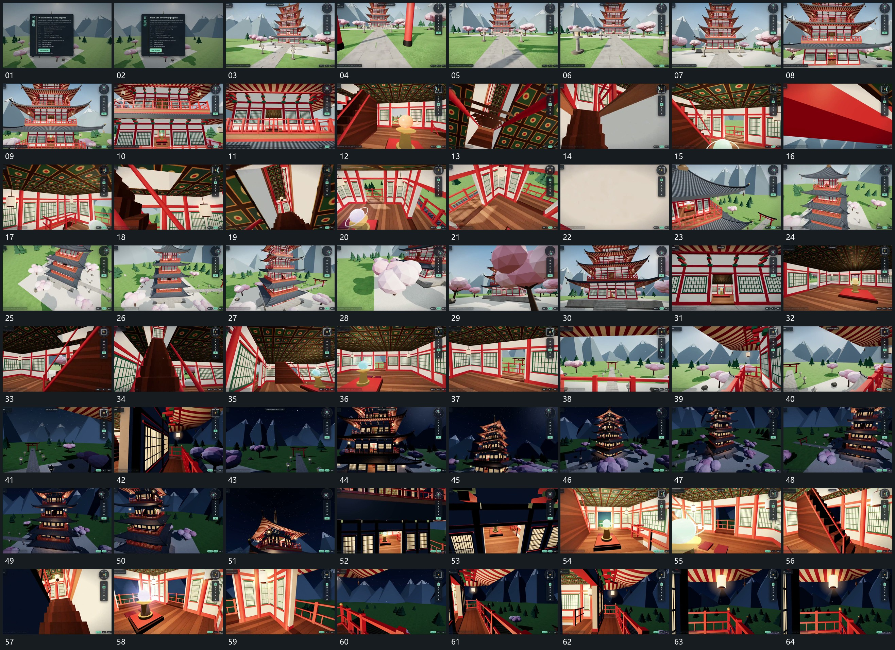

# 096｜原片运动总览

[观看完整原片](video.mp4)

## 运动总览

全片围同一空间多次运镜。起段沿中心通道推进同时抬高取景沿中心通道推进并逐步抬高取景，随后沿上扬路径转角穿过框边进入下一层沿上扬路径穿过框状边界，近侧遮挡先后经过。到外部后，围中央长组绕行并连续改变俯仰高度围中央长组绕行，观察角度由斜下方转向侧上方，再回到正向入口。

进入内部后继续复用沿上扬路径转角穿过框边进入下一层，在不同高度转向旁侧开口；后层状态接替后，仍沿原空间重复围中央长组绕行并连续改变俯仰高度与沿上扬路径转角穿过框边进入下一层。固定小参照条与前框只作观看参照，静止内容不增加机制。

## 完整运动段落

以下按原片中的出现顺序引用。建立、内部发展及完成反馈放在同一段中；同时发生的局部动作与运镜写在同一份指令里。不同段之间可以是连续接管，也可以是直接切换，不能仅凭条目相邻认定可直接拼接。重复出现的同类运动采用一次连续代表范围，切片不以逐段无缝覆盖整片为目标。

1. [沿中心通道推进同时抬高取景](mechanisms/m01.md)：前进与取景抬高交叠

2. [沿上扬路径转角穿过框边进入下一层](mechanisms/m02.md)：上移转角遮挡经过

3. [围中央长组绕行并连续改变俯仰高度](mechanisms/m03.md)：绕行与高度变化交叠

切片保留起始准备、必要内部停顿和完成或明确交接；首尾省略无新发展的等待，持续运动不要求人为停住。以上基于真实源帧序列和重点边界核对，不等同于全片连续声画审片。

## 完整64宫格

