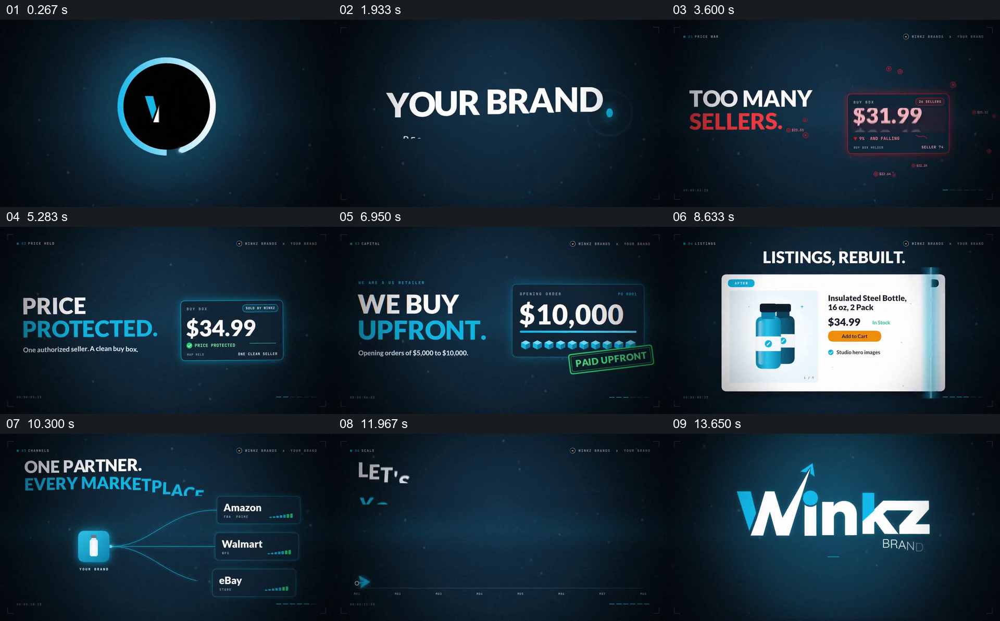

# 围绕品牌问题依次切换价格、采购、商品页面与渠道

- 作品：案例 088。
- 原片范围：00:00.000–00:15.061（源时间，起点包含、终点不包含）；[完整原片](../video.mp4)｜[本卡片段](../video.mp4)。范围按画面的完整表达确定；视频与分镜引用现有文件。
- 观察方式与未确认范围：查看完整原片 64 帧总览和本卡分镜；未独立连续原速观看及听审，抽帧间动作、精确速度、声音与同步均未确认；以下价值判断是作品分析，迁移尚未实测。

## 原画面具体怎样设计

深色蓝黑空间中先出现标志，再以“YOUR BRAND”建立讨论对象。画面转到左侧大字“TOO MANY SELLERS.”和右侧红色价格卡：周围有多个小价格点，卡内数字下降；接着同一区域变成青色“PRICE PROTECTED.”和带对勾的价格卡。

下一阶段左侧显示“WE BUY UPFRONT.”，右侧订单金额和小方块组成一张采购卡；再出现“LISTINGS, REBUILT.”，一张商品网页从较弱的展示状态变为蓝色保温瓶、价格、购买按钮和勾选列表更清楚的页面。随后页面退出，左侧小瓶子图标以几条线连接右侧 Amazon、Walmart 和 eBay 卡片；最后增长曲线与品牌标识接管画面。

## 为什么这样设计，好在哪里

各阶段共享深色背景、左侧简短主张和右侧具体界面，观众可以连续识别这是同一套介绍；红色的价格问题和青色的受保护状态在相近位置前后对照，使问题与回应容易建立对应。

商品网页先给出较弱状态再给出更清楚的结果，随后小瓶子连接多个渠道，形成从单页到分发的扩展。需要注意，价格卡、订单和渠道图标是片中演示；画面不能证明同一真实商品经历了这些商业结果，也不能证明采购、价格或销售增长已经发生。
