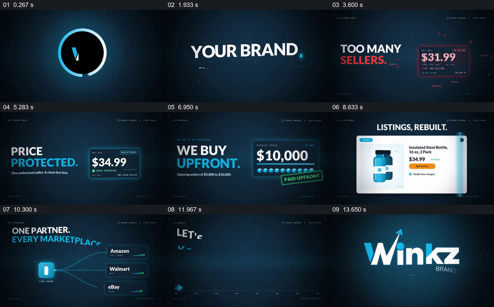

# 让一件商品穿过价格、采购、页面和多渠道展示

- 作品：案例 088《品牌渠道服务介绍》（本次概括）。
- 原片范围：00:00.000–00:15.061，含起点、不含终点；[完整原片](../video.mp4)｜[本卡片段](../video.mp4)。
- 观察方式：依据约每秒一次的真实源帧观察，未连续原速观看或听审；声音、语气与完整播放节奏未确认。

## 原画面具体怎样设计

深色科技风画面先建立标志和品牌文字；红色价格卡表示价格问题，随后变成蓝色的保护价格。采购金额数字变化并出现预付标识，商品页面从简略状态转为带图片和信息的页面；同一商品图标再连接多个销售平台，最后增长曲线和品牌标志出现。

## 为什么这样设计，好在哪里

同一商品贯穿多项服务，数字卡、页面与平台连线分别给每个承诺一个可辨对象；末尾汇总图使片中项目回到一个增长目标。价格、采购金额及增长为宣传示意。

以上为依据画面的分析，非作者自述；预期观看效果未经观众测试。

## 可直接使用的创意指令

概括围绕商品的多项服务时，选一个可核对的商品示例，分别展示服务介入前后的价格、采购、页面或渠道状态，最后汇总服务范围；每项承诺和数字须与实际合同或数据一致，图表不得伪装成实测结果。
