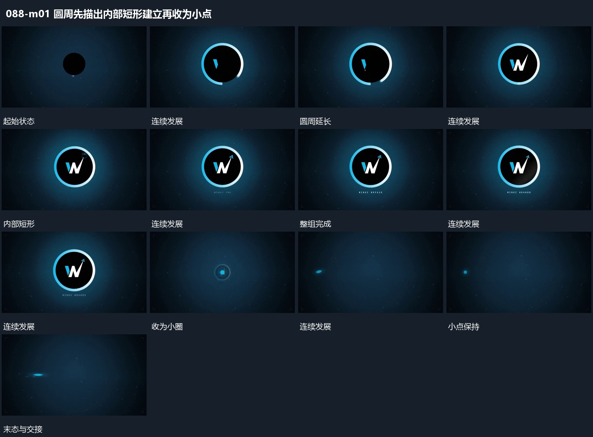

# 圆周先描出内部短形建立再收为小点

## 运动指令

围中央小圆面逐步描出完整圆周，内部短形随后分段建立。下方小行最后加入，整组保持后连同圆周一起缩小，变成中央小点，给下一字行留下共同起点。

## 视频切片

[播放本机制的原片切片](m01.mp4)

保留起始准备、连续发展和完成或明确交接；首尾按本段运动范围裁切，不拼接、不变速。尾部只保留理解结果所需的展示。

## 分镜过程

## 组合与调整

可改变内部形状；缩回保留中心与整体身份，不把旧组直接淡出换成无关小点。
