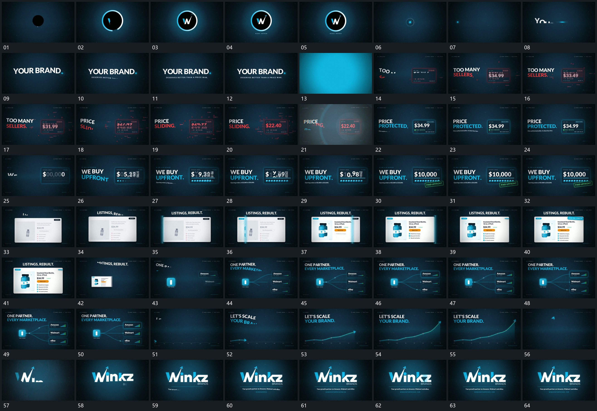

# 088｜原片运动总览

[观看完整原片](video.mp4)

## 运动总览

全片由圆周先描出内部短形建立再收为小点的圆周描出与内部短形建立开始，圈收小后接到字行分段展开。之后固定框内数字片竖向接替最后停稳在固定框内竖向接替数字片，旁侧短行同步补齐；弧形覆盖经过原框内部与旁行原位更新用弧形覆盖经过整组，保留框位置并更新内部。

下一框继续复用固定框内数字片竖向接替最后停稳并在底部累积小片。窄竖带扫过宽片面经过处依次换内容让窄竖带横过宽片面，经过处依次替换内容；宽片缩回后，单点向多旁框延长连接端部短条逐项增高由单点分出多条连接并接入旁框。后段箭头沿上扬曲线延长留下节点后离线接续沿底部逐段延长上扬曲线，箭头从线端离开并回到中央，最后主字形从局部展开下线与附属行后补齐逐段建立主字形与下方附属行。

## 完整运动段落

以下按原片中的出现顺序引用。建立、内部发展及完成反馈放在同一段中；同时发生的局部动作与运镜写在同一份指令里。不同段之间可以是连续接管，也可以是直接切换，不能仅凭条目相邻认定可直接拼接。重复出现的同类运动采用一次连续代表范围，切片不以逐段无缝覆盖整片为目标。

1. [圆周先描出内部短形建立再收为小点](mechanisms/m01.md)：描圈建立后整体缩回

2. [固定框内数字竖向轮换，弧形覆盖后同步换态落稳](mechanisms/m08.md)：固定数框中数字按竖向接替变化，旁字保持同步；弧形覆盖扫过后框内数值与旁字原位更新并共同稳定。

3. [窄竖带扫过宽片面经过处依次换内容](mechanisms/m04.md)：横向扫带渐进替换

4. [单点向多旁框延长连接端部短条逐项增高](mechanisms/m05.md)：连接延伸旁框接入

5. [箭头沿上扬曲线增长，离开轨迹后衔接主字与附属行](mechanisms/m09.md)：箭头沿曲线向上推进并留下节点，离开曲线后成为字组附近锚点；主字展开、下线与附属行随后补齐。

切片保留起始准备、必要内部停顿和完成或明确交接；首尾省略无新发展的等待，持续运动不要求人为停住。以上基于真实源帧序列和重点边界核对，不等同于全片连续声画审片。

## 完整64宫格

