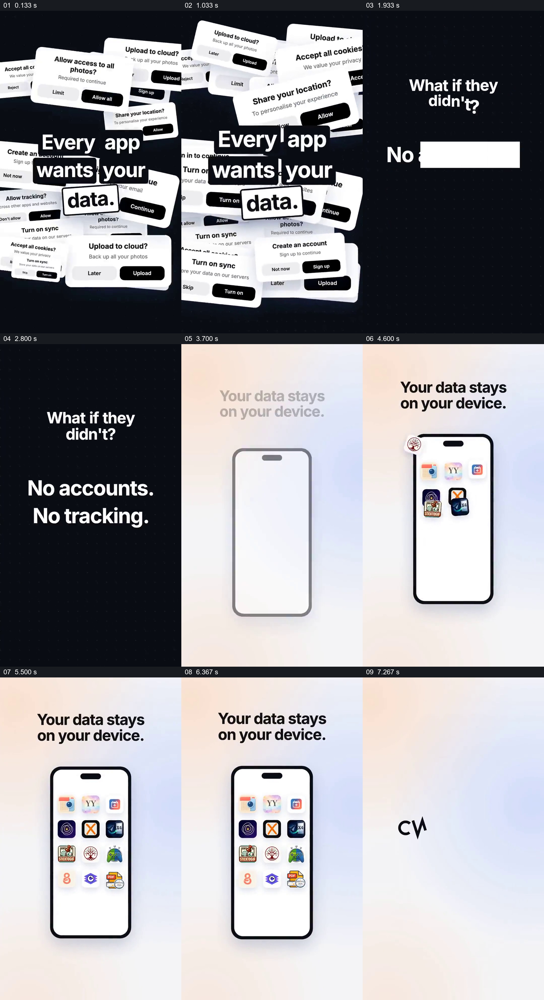

# 把拥挤的权限请求翻转成设备内的应用集合

- 作品：案例 044《多手机、照片与年度回顾》（库内索引名）。
- 原片范围：00:00.000–00:08.000，含起点、不含终点；[完整原片](../video.mp4)｜[本卡片段](c01.mp4)，片段起点对应原片 0.000 秒。
- 范围依据：0–8 秒从请求堆叠、反问到设备内应用集合与品牌承接，共同表达一项隐私主张；随后进入多产品展示。
- 观察方式：核看全片 64 帧总览及本卡九宫格；未独立连续原速观看，快速变化和运动节奏待核。未独立听审，声音内容未知。片中事实和演示未独立查证，新题材迁移尚未实测。

## 原画面具体怎样设计

黑底上同时叠放许多白色对话框，内容涉及上传云端、访问照片、共享位置、开启同步等；它们围绕中央黑白字组 “Every app wants your data.”，有的画框被边缘裁切。随后画面清空为黑底白字 “What if they didn’t?”，再逐行给出 “No accounts.”、“No tracking.” 等短句。

背景随一个浅色圆形扩张变成柔和浅色，中央出现手机轮廓，上方是 “Your data stays on your device.”。若干不同应用图标陆续进入设备屏内，最终在手机里组成整齐网格；网格和文字退去后，品牌字样出现。它们是片中的数据和隐私主张，动画不能证明真实存储、追踪或权限行为。

## 为什么这样设计，好在哪里

前半把熟悉的不同权限请求挤在同一幅画面，给抽象的数据问题一个具体而拥挤的视觉形象；清空后仅保留反问和短句，形成明显的阅读重置。后半的手机成为一个清晰边界，多个应用图标被放在边界内，使“设备内”主张获得直观的空间比喻，并同时引出后面的产品集合。关键不只是弹窗飞动或换背景，而是“多个具体请求—一句替代主张—设备和应用的对应”这条关系。图标聚在屏幕里只是一种说明方式，不是对隐私实现的证据；观看效果也未做受众测试。

## 可直接使用的创意指令

适合有明确、可核查替代方案的产品说明：选取用户实际可能遇到的几种请求或负担，用具体界面元素在同一画面中建立问题；腾出阅读空间后，以准确的短句提出本产品的区别，再用真实设备、应用和数据去向之间的空间关系说明这句话。多个产品共用一个条件时可把它们作为集合展示，并在后续连接到各自的实际功能。弹窗数量、色彩与容器由内容决定；如果没有政策、产品行为或其他可靠依据，不把“无追踪”或“留在本地”写成事实，也不让图标动画代替验证。
