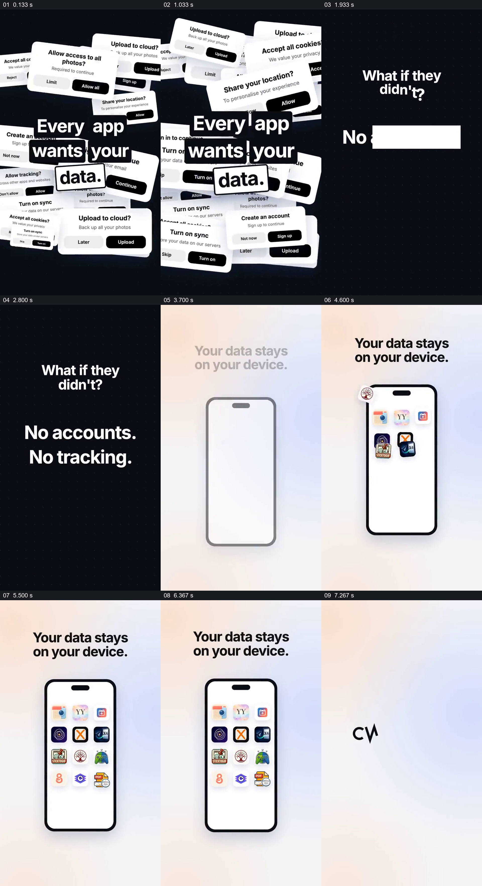

# 把拥挤的权限请求翻转成设备内的应用集合

- 作品：案例 044《多手机、照片与年度回顾》（库内索引名）。
- 原片范围：00:00.000–00:08.000，含起点、不含终点；[完整原片](../video.mp4)｜[本卡片段](c01.mp4)，片段起点对应原片 0.000 秒。
- 范围依据：0–8 秒从请求堆叠、反问到设备内应用集合与品牌承接，共同表达一项隐私主张；随后进入多产品展示。
- 观察方式：核看全片 64 帧总览及本卡九宫格；未独立连续原速观看，快速变化和运动节奏待核。未独立听审，声音内容未知。片中事实和演示未独立查证，新题材迁移尚未实测。

## 原画面具体怎样设计

黑底上同时叠放许多白色对话框，内容涉及上传云端、访问照片、共享位置、开启同步等；它们围绕中央黑白字组 “Every app wants your data.”，有的画框被边缘裁切。随后画面清空为黑底白字 “What if they didn’t?”，再逐行给出 “No accounts.”、“No tracking.” 等短句。

背景随一个浅色圆形扩张变成柔和浅色，中央出现手机轮廓，上方是 “Your data stays on your device.”。若干不同应用图标陆续进入设备屏内，最终在手机里组成整齐网格；网格和文字退去后，品牌字样出现。它们是片中的数据和隐私主张，动画不能证明真实存储、追踪或权限行为。

## 为什么这样设计，好在哪里

前半把熟悉的不同权限请求挤在同一幅画面，给抽象的数据问题一个具体而拥挤的视觉形象；清空后仅保留反问和短句，形成明显的阅读重置。后半的手机成为一个清晰边界，多个应用图标被放在边界内，使“设备内”主张获得直观的空间比喻，并同时引出后面的产品集合。关键不只是弹窗飞动或换背景，而是“多个具体请求—一句替代主张—设备和应用的对应”这条关系。图标聚在屏幕里只是一种说明方式，不是对隐私实现的证据；观看效果也未做受众测试。

## 完整照排指令

以[完整原片](../video.mp4)的 0–8 秒为准。画幅 720×1280，源帧率 30/1。以下拍点为抽帧定位，位置按画幅百分比取近似值。

### 用料

【权限弹窗组】备可辨的权限用途和按钮短字，界面使用自有或授权素材。备【数据主句】【反问句】【处理承诺组】【设备主句】【应用图标组】【品牌字】【品牌副句】。每条隐私承诺应有对应应用及版本的可打开政策或技术说明。

### 按源时刻摆放

1. **0–约 1.500 秒。** 竖幅近黑，暖白【权限弹窗组】以不同倾角挤入四边。中央留三行粗【数据主句】，前两行白字压黑，末词用黑字压浅纸。弹窗短移，允许静态分层；只在全组退场时清掉邻层。
2. **约 1.500–3.500 秒。** 切纯暗底，顶中小一档白粗【反问句】两行。下方由上至下补三行白粗【处理承诺组】，保持先到的行可读。
3. **约 3.500–7.000 秒。** 浅杏至淡蓝渐变切入。顶部黑粗【设备主句】两行，中下竖直白屏手机细黑边固定。【应用图标组】从内外不同方向落成三列四行，先到者留下，图标不跨出框外留在最终态。约 7 秒手机退场。
4. **约 7.000–8.000 秒。** 浅底中轴留黑色【品牌字】及更小疏排【品牌副句】，按 8 秒切出。

### 局部采用

只采用设备图标演出时用约 3.500–7 秒，若保留数据承诺，须有对应版本的可核对依据。

### 验证状态

已对照每秒两帧原片画序并读回，核对弹窗清空、承诺逐行铺排、图标进入并留在同一手机。精确切点和换料待核。
