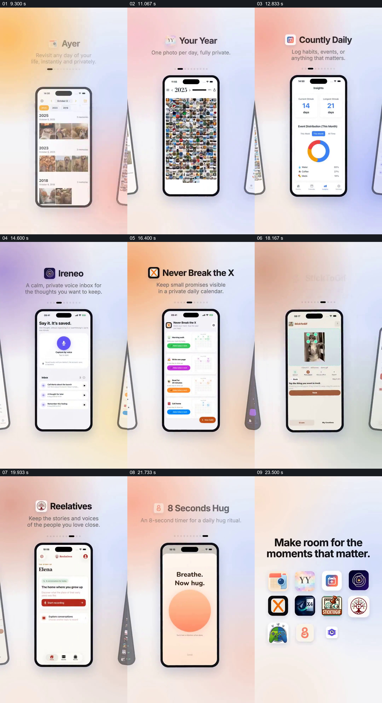

# 让不同应用轮流占据同一展示位，最后汇成一组

- 作品：案例 044《多手机、照片与年度回顾》（库内索引名）。
- 原片范围：00:09.000–00:25.000，含起点、不含终点；[完整原片](../video.mp4)｜[本卡片段](c02.mp4)，片段起点对应原片 9.000 秒。
- 范围依据：9–25 秒从第一个应用完整展示到多项轮换与图标汇总，属于一套产品集合讲法；8–9 秒为品牌过渡，25 秒后为结束入口。
- 观察方式：核看全片 64 帧总览及本卡九宫格；未独立连续原速观看，快速变化和运动节奏待核。未独立听审，声音内容未知。片中事实和演示未独立查证，新题材迁移尚未实测。

## 原画面具体怎样设计

浅色柔和渐变背景中，每次由一部手机占据中央，手机上方依次放该应用的图标、名称及一两行用途说明。先后可见照片回顾、年度照片拼图、习惯统计、语音收件箱、日历、动图工具和其他应用；中央屏幕内容随对应应用一起更换。画面两侧经常留下倾斜的其他手机边缘，顶部一排小点中的深色点标示当前项。

各应用展示完后，手机页面让位给居中的短句 “Make room for the moments that matter.”，此前见过的应用图标逐项组成网格；接着进入品牌及网址结束页。内容都是原片的产品介绍，实际功能未独立核实。

## 为什么这样设计，好在哪里

固定的中间展示尺度让观众知道每次应该看哪里；名称、用途和对应页面同时变化，可以从一张画面把一款应用的身份与用途配起来。倾斜的边缘设备和位置点提示它属于更长的系列，而不是一个个无关截图。最后把见过的图标重新排列成网格，前面的逐项展示便收束为同一产品集合。若只堆图标而没有每项页面与用途，很难理解各自差别；若每个项目任意换展示位置，比较所需的共同参照会减弱。以上为可见设计分析，非功能验证。

## 可直接使用的创意指令

介绍多个产品、项目或案例时，为每项准备可核对的真实画面、名称和一句描述其用途的话。在稳定的展示区域逐项配对名称、说明和主要画面，让上一项或下一项以轻微边缘提示维持系列感；每次切换要保持标题与画面身份一致，并给复杂内容足够阅读时间。全部项目展示后，可把各自标识汇成集合，并接入统一入口。无需固定为手机、圆点或特定颜色；项目过多或用途差异无法在简短时间内读清时应调整数量与停留，不依靠同一外壳掩盖内容差异。
