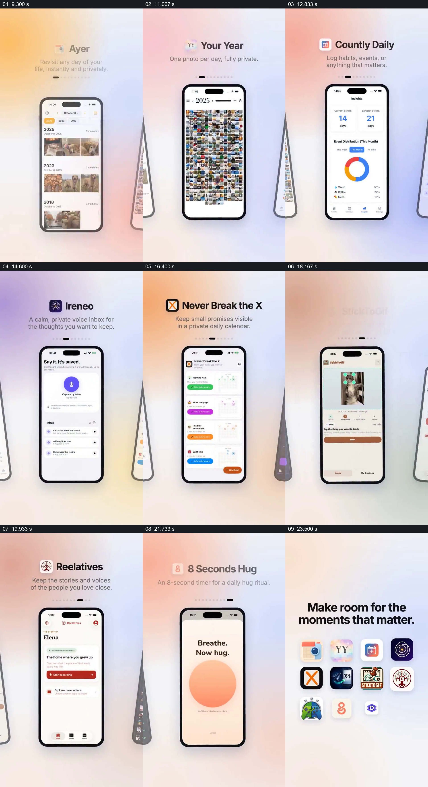

# 让不同应用轮流占据同一展示位，最后汇成一组

- 作品：案例 044《多手机、照片与年度回顾》（库内索引名）。
- 原片范围：00:09.000–00:25.000，含起点、不含终点；[完整原片](../video.mp4)｜[本卡片段](c02.mp4)，片段起点对应原片 9.000 秒。
- 范围依据：9–25 秒从第一个应用完整展示到多项轮换与图标汇总，属于一套产品集合讲法；8–9 秒为品牌过渡，25 秒后为结束入口。
- 观察方式：核看全片 64 帧总览及本卡九宫格；未独立连续原速观看，快速变化和运动节奏待核。未独立听审，声音内容未知。片中事实和演示未独立查证，新题材迁移尚未实测。

## 原画面具体怎样设计

浅色柔和渐变背景中，每次由一部手机占据中央，手机上方依次放该应用的图标、名称及一两行用途说明。先后可见照片回顾、年度照片拼图、习惯统计、语音收件箱、日历、动图工具和其他应用；中央屏幕内容随对应应用一起更换。画面两侧经常留下倾斜的其他手机边缘，顶部一排小点中的深色点标示当前项。

各应用展示完后，手机页面让位给居中的短句 “Make room for the moments that matter.”，此前见过的应用图标逐项组成网格；接着进入品牌及网址结束页。内容都是原片的产品介绍，实际功能未独立核实。

## 为什么这样设计，好在哪里

固定的中间展示尺度让观众知道每次应该看哪里；名称、用途和对应页面同时变化，可以从一张画面把一款应用的身份与用途配起来。倾斜的边缘设备和位置点提示它属于更长的系列，而不是一个个无关截图。最后把见过的图标重新排列成网格，前面的逐项展示便收束为同一产品集合。若只堆图标而没有每项页面与用途，很难理解各自差别；若每个项目任意换展示位置，比较所需的共同参照会减弱。以上为可见设计分析，非功能验证。

## 完整照排指令

以[完整原片](../video.mp4)的 9–25 秒为准。画幅 720×1280，源帧率 30/1。以下拍点为抽帧定位，位置按画幅百分比取近似值。

### 用料

【应用名组】【用途句组】【手机实录组】【应用图标组】按同一发布系列逐项对应。每页都需一眼可辨的主要功能状态。另备【集合主句】【品牌字】【入口地址】。功能事实附可打开的应用说明。

### 按源时刻摆放

1. **9.000–约 13.000 秒。** 竖幅浅杏蓝渐变。首个白手机居中，近 x27%–73%，顶部约 y30%。其上居中放小【应用图标组】、黑粗【应用名组】和小灰【用途句组】，再用极短黑横线与手机间隔。照片列表切到照片集合、再到读数页面。换机时两边露出倾斜设备边，主位与标题同拍更新。
2. **约 13.000–21.000 秒。** 沿同一路径轮换余下应用，把主机始终保在相同的正面槽。相邻设备随移动仅露侧缘。背景随主应用轻换紫、暖杏或淡绿，保持亮度。每张【手机实录组】从可见至离场保持自己的时间；可用对应静态截屏，不让循环改变功能状态。不能使用同一界面却换成另一产品名。
3. **约 21.000–23.600 秒。** 最后一台手机退，顶部偏中以黑粗两行【集合主句】建立。下方沿四列逐步累积同一批【应用图标组】，已入图标保持到组齐；静态图标从各自入场至切出不换。
4. **约 23.600–25.000 秒。** 图标退场，浅底居中换黑【品牌字】，其下黑胶囊反白【入口地址】，留至 25 秒切出。

### 局部采用

只有相邻两三项时可取对应换机片段，保留两侧设备提示。仅有图标与入口可取约 21–25 秒。

### 验证状态

已对照每秒两帧原片画序并读回，核对标题与手机相位、相邻设备露边，以及图标组和入口切出。精确切点与换料待核。
