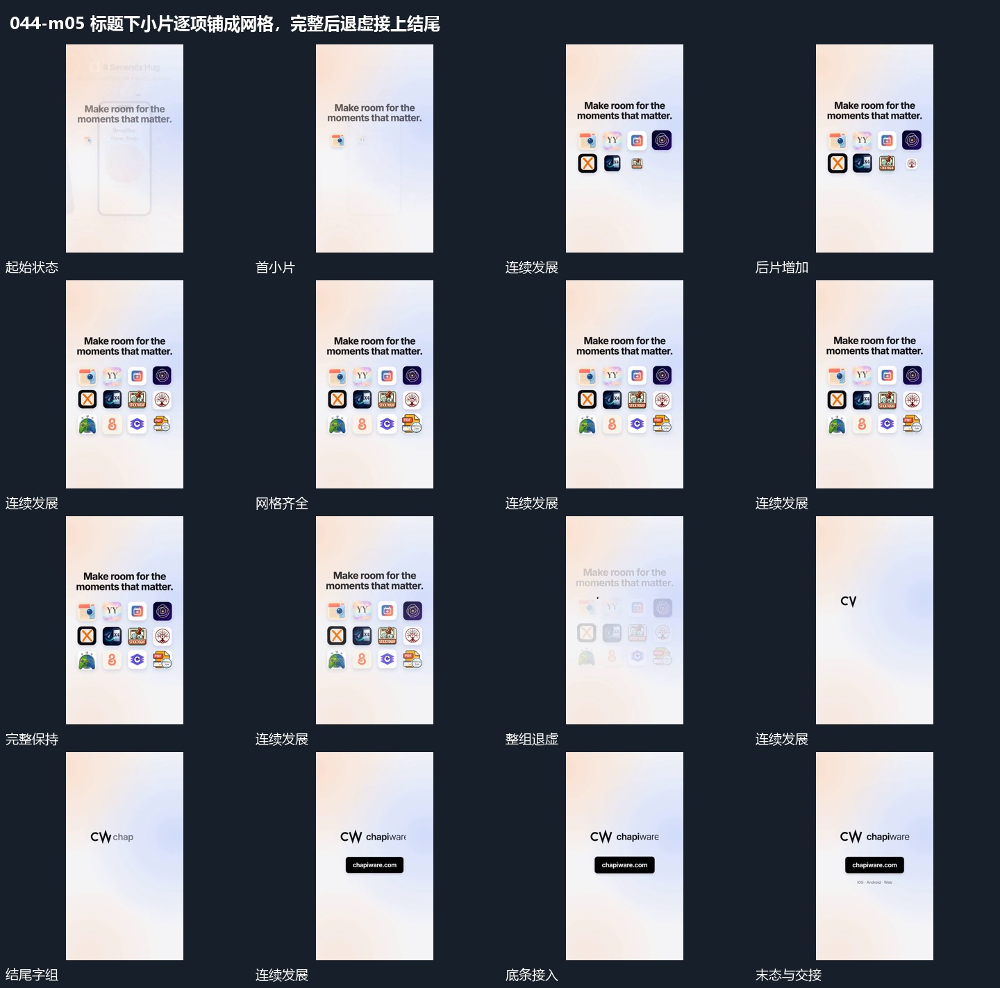

# 标题下小片逐项铺成网格，完整后退虚接上结尾

## 运动指令

保持上方标题，在其下逐项增加小片，按固定空位铺成网格。完整集合保持后整体退虚，再接入中央短字组，底条与附属小行随后补齐。

## 视频切片

[播放本机制的原片切片](m05.mp4)

覆盖分镜中“首小片”至“底条接入”的连续过程，并保留邻近的前后衔接画面；原片中交叠发生的动作一并保留。

## 分镜过程

## 组合与调整

网格收尾可接其他镜头，但需先确立完整结果，避免最后小片刚进来整组就退出。
