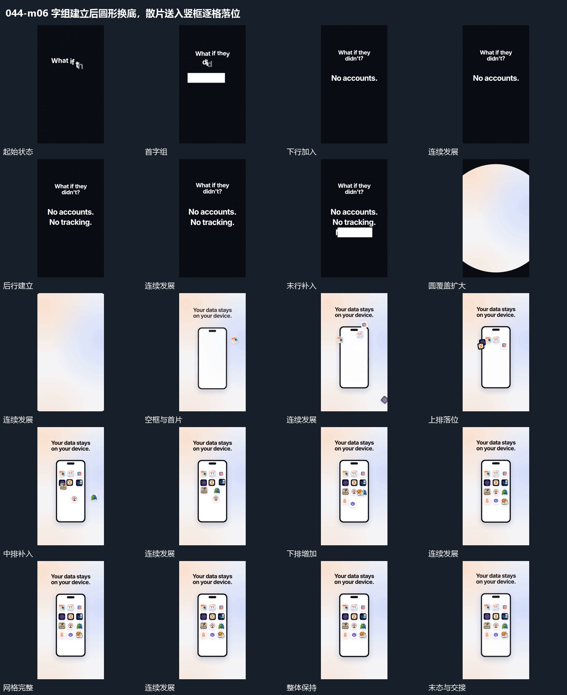

# 字组建立后圆形换底，散片送入竖框逐格落位

## 运动指令

字组逐行建立，圆形覆盖扩张交出画面；新空竖框接入，小片沿不同路径送入并在内部网格落稳。

1. **字组分行建立，圆形覆盖扩张后新底层接管**

在空场中分行建立字组，前行保持，后行按顺序追加。字组完成后从中央扩开圆形覆盖，覆盖越过边缘时换入新底层，由新的竖框和上字接管。

2. **散开小片依次送入空竖框，在固定网格落位**

保留空竖框，把周边小片按顺序送入框内，各自落到对应网格空位。先填上部再补中下部，已落位片保持位置，最后形成完整集合，外框与标题一起稳定。

整段结束：框内网格齐全 保留必要落稳与交接，中间已建立的参照沿用到下一步骤。

## 视频切片

[播放本机制的原片切片](m06.mp4)

保留起始准备、连续发展和完成或明确交接；首尾按本段运动范围裁切，不拼接、不变速。相连的小动作合为同一完整段落。

## 分镜过程

## 组合与调整

字组逐行建立，圆形覆盖扩张交出画面；新空竖框接入，小片沿不同路径送入并在内部网格落稳。 复用时可调整元素数量、幅度和相对节奏，保留上述进入、交叠与完成关系；不直接沿用原片题材或时长。

圆形范围要能覆盖新旧交界，不把局部放大误当全场转场。

小片来源应能追踪，少量位置交叠不影响落位顺序。数量可换。
