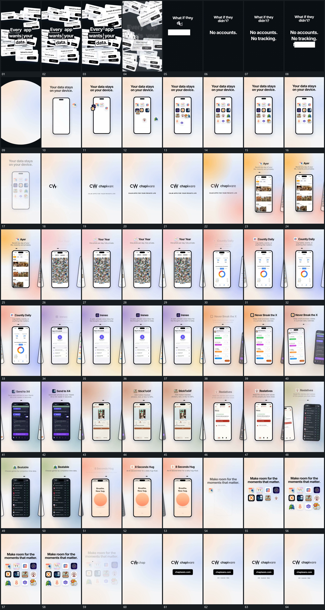

# 044｜原片运动总览

[观看完整原片](video.mp4)

## 运动总览

开头 中央字组保持，外围倾斜片持续堆叠并放大越界 保留中央字组，外围倾斜片持续堆叠并放大，随后整体退去。字组分行建立，圆形覆盖扩张后新底层接管 在新空间分行建立字组，再以圆形覆盖扩张换底。散开小片依次送入空竖框，在固定网格落位 立起空竖框，将散开的小片依次送入框内网格，完整后退虚。

中段主字建立，随后 竖片列侧向经过，选片转正接管中央，旁片停在边缘 让一列竖片侧向经过，选定片转正接管中央，旁片停留在边缘；每次接管时上方文字原位更新，这一机制在多段重复使用。末段 标题下小片逐项铺成网格，完整后退虚接上结尾 在稳定标题下方逐项铺成小片网格，完整后整组退虚，短字组与底条分项建立收尾。

## 完整运动段落

以下按原片中的出现顺序引用。建立、内部发展及完成反馈放在同一段中；同时发生的局部动作与运镜写在同一份指令里。不同段之间可以是连续接管，也可以是直接切换，不能仅凭条目相邻认定可直接拼接。重复出现的同类运动采用一次连续代表范围，切片不以逐段无缝覆盖整片为目标。

1. [中央字组保持，外围倾斜片持续堆叠并放大越界](mechanisms/m01.md)：中心不动，外围增多与前移

2. [字组建立后圆形换底，散片送入竖框逐格落位](mechanisms/m06.md)：字组逐行建立，圆形覆盖扩张交出画面；新空竖框接入，小片沿不同路径送入并在内部网格落稳。

3. [竖片列侧向经过，选片转正接管中央，旁片停在边缘](mechanisms/m04.md)：整列移动，中央片逐步转正

4. [标题下小片逐项铺成网格，完整后退虚接上结尾](mechanisms/m05.md)：逐项累积后整组退出

切片保留起始准备、必要内部停顿和完成或明确交接；首尾省略无新发展的等待，持续运动不要求人为停住。以上基于真实源帧序列和重点边界核对，不等同于全片连续声画审片。

## 完整64宫格

