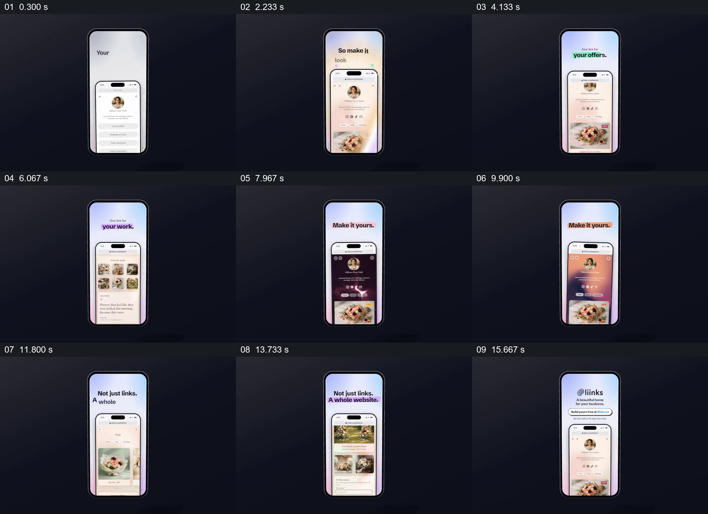

# 固定外层手机，让同一个花店主页展示内容与风格变化

- 作品：案例 037《手机中的照片与主页》（库内索引名称）。
- 原片范围：00:00.000–00:17.267，含起点、不含终点；[完整原片](../video.mp4)｜[本卡片段](../video.mp4)。
- 范围依据：从空白手机与个人链接页建立，到内容、配色、网站页面及品牌入口；保留整片。
- 观察方式与未确认范围：查看整片 64 帧总览和本卡分镜。未独立完成连续原速观看与听审；抽帧之间的运动、停顿与声音配合待复核。画面中的界面、数字与说明是作品呈现，未经额外核实；设计价值为基于画面的分析。

## 原画面具体怎样设计

深蓝黑色背景中央是一部竖直外层手机，顶部出现“你的个人主页链接就是店面”一类说明；下方又嵌入一部较小手机，里面是人物头像和简洁链接列表。之后内层页面出现鲜花照片、个人介绍与商品入口，外层顶部文字提示将它做成自己的店面。

顶部标题先后强调 offers 和 work；内层相应显示鲜花商品、列表和多张作品图。接着“Make it yours”出现，同一头像、花束与页面位置仍可辨认，但页面主题先后呈现深紫、浅绿、橙色等不同外观。

最后外层标题转为“不只是链接，还是完整网站”，内层显示鲜花商品和较长的网页内容；品牌名称及行动入口出现在外层手机上部，花店主页仍保留在下方。外层设备和深色舞台持续作为稳定参照。

## 为什么这样设计，好在哪里

外层手机始终固定，观众可把注意力集中于内部主页内容与风格的变化，而不用重新识别设备。重复的头像和花束提供同一主体的参照，顶部短句则解释当前展示的是商品、作品还是外观；最后的长页面扩展了最初的链接列表，让“完整网站”有具体画面。

这是界面演示，抽帧不能证明页面可交互或样式切换实时发生。

## 可直接使用的创意指令

选一个身份和素材一致的真实案例，用固定窗口作为外层观看容器；内部先展示最基础的页面，再依次展示服务、作品或商品等不同内容。需要比较样式时保留头像、主要图片与结构，只改变确实可调的颜色或版式；最后展示更完整的使用结果，并给出真实入口。

可换为餐厅、摄影师或机构页面，外层不必是手机；关键是同一主体与变化内容的对应，界面演示和真实产品状态要区分。

本方法尚未在新题材中实测。
