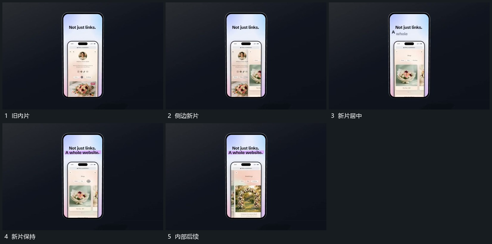

# 新竖片侧向接入，把旧片推至边缘后继续承载

## 运动指令

从侧边接入新的竖片，让旧片同向移动到边缘，新片在中央接管。交接期间两片短暂并置，外框保持；新片落稳后再继续内部内容的纵向展示。

## 视频切片

[播放本机制的原片切片](m04.mp4)

覆盖分镜中“旧内片”至“内部后续”的连续过程，并保留邻近的前后衔接画面；原片中交叠发生的动作一并保留。

## 分镜过程

## 组合与调整

新旧片要共享边界和方向，避免旧片先切掉造成来源中断。
