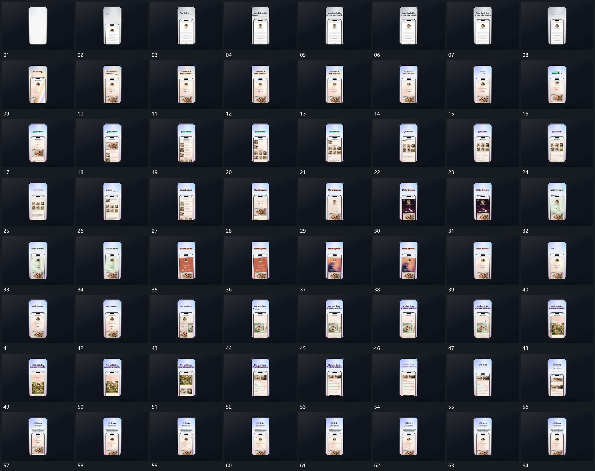

# 037｜原片运动总览

[观看完整原片](video.mp4)

## 运动总览

全片外部竖框持续保留。开头 内竖片从下接入，上方字组分行建立 从底部接入内竖片，上方字组分行建立；斜向亮带扫过内片，旧内容由新状态接替 让斜向亮带扫过，替换内部材料。中段 框内长内容上滚，外部字组原位接替 在框内上滚长内容，上方短词原位接替并补强调带。

后段多次重用 斜向亮带扫过内片，旧内容由新状态接替 改换内部状态，再以 新竖片侧向接入，把旧片推至边缘后继续承载 从侧边接入新片，把旧片推到边缘，继续沿用 框内长内容上滚，外部字组原位接替 上滚展示长内容。结尾上字与下条错开建立，内部返回先前状态，外部边界保持。

## 完整运动段落

以下按原片中的出现顺序引用。建立、内部发展及完成反馈放在同一段中；同时发生的局部动作与运镜写在同一份指令里。不同段之间可以是连续接管，也可以是直接切换，不能仅凭条目相邻认定可直接拼接。重复出现的同类运动采用一次连续代表范围，切片不以逐段无缝覆盖整片为目标。

1. [内竖片升入建立，斜向亮带扫过后换成新状态](mechanisms/m05.md)：先完成竖片与上方字组，再由亮带斜向扫过内部，旧内容被新状态接替，外部框架保持。

2. [框内长内容上滚，外部字组原位接替](mechanisms/m03.md)：内部上滚，外框与上方位置保持

3. [新竖片侧向接入，把旧片推至边缘后继续承载](mechanisms/m04.md)：新片从侧入，旧片同向让位

切片保留起始准备、必要内部停顿和完成或明确交接；首尾省略无新发展的等待，持续运动不要求人为停住。以上基于真实源帧序列和重点边界核对，不等同于全片连续声画审片。

## 完整64宫格

