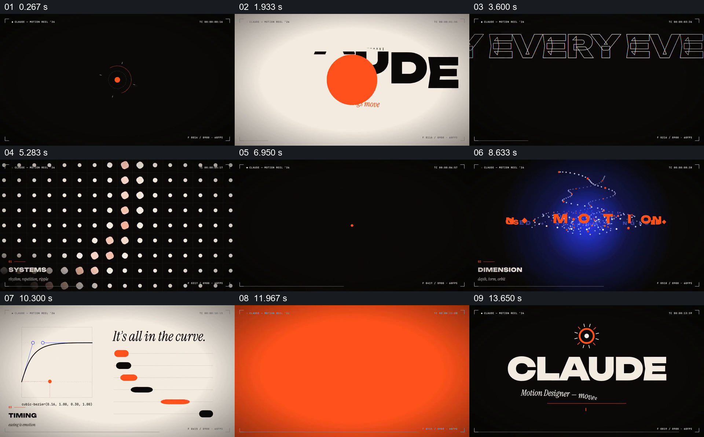

# 用点阵、空间粒子和曲线，把运动设计的不同侧面变成画面

- 作品：案例 110《字体、空间与曲线示意》（库内索引名称）。
- 原片范围：00:00.000–00:15.061，含起点、不含终点；[完整原片](../video.mp4)｜[本卡片段](../video.mp4)。
- 范围依据：从黑底橙点与开篇字体，到系统、空间、时间曲线、关键词和署名；整片保留。
- 观察方式与未确认范围：查看整片 64 帧总览和本卡分镜。未独立完成连续原速观看与听审；抽帧之间的运动、停顿与声音配合待复核。画面中的界面、数字与说明是作品呈现，未经额外核实；设计价值为基于画面的分析。

## 原画面具体怎样设计

黑底中央先有橙点及细环，再出现横线和浅底大字 CLAUDE；橙、白、蓝、黑色画面依次出现“I MAKE”“PIXELS”“MOVE”“WITH INTENT”等字句，角落保留小型帧号与边框标记。

标为 SYSTEMS 的黑底区域铺满规则浅色小点，部分点在不同抽帧中形成弯曲或不同大小的图案；DIMENSION 段则在蓝色光晕周围显示细小粒子、字母和螺旋形轨迹。随后浅底画面左侧是带控制点的曲线图，右侧多条黑橙短条排列，旁边写“It’s all in the curve”，小字标为 TIMING。

结尾用几个大字画面概括 KINETIC、3D、SYSTEMS、LOOPS，最后回到黑底署名。点、细线、橙色强调和角落信息在各画面中反复出现。

## 为什么这样设计，好在哪里

作品没有只用文字宣布擅长运动：重复点阵、空间中的粒子和曲线图分别提供系统、空间与时间的可见例子。稳定的角标和有限色彩将不同视觉例子连成同一作品集，结尾关键词又把刚看过的画面归纳为几个可记住的方向。

曲线、帧号和 60 FPS 是画中标注；本次没有核对它们与实际动画参数的关系，也不能由静帧判断运动速度或节奏。

## 可直接使用的创意指令

把要介绍的能力拆成少数彼此不同的方面，为每一方面设计一个观众一眼可辨的具体画面；例如用重复对象表现系统，用空间中的点或真实物体表现深度，用可核对的曲线和运动结果说明时间。保持共同的色彩或版式，最后用简短标签回扣此前示例。

可替换为摄影、数据或产品设计等题材，不必使用粒子或曲线；当展示参数和成品关系时，应确保图示与真实设置对应，并通过连续观看检查。

本方法尚未在新题材中实测。
