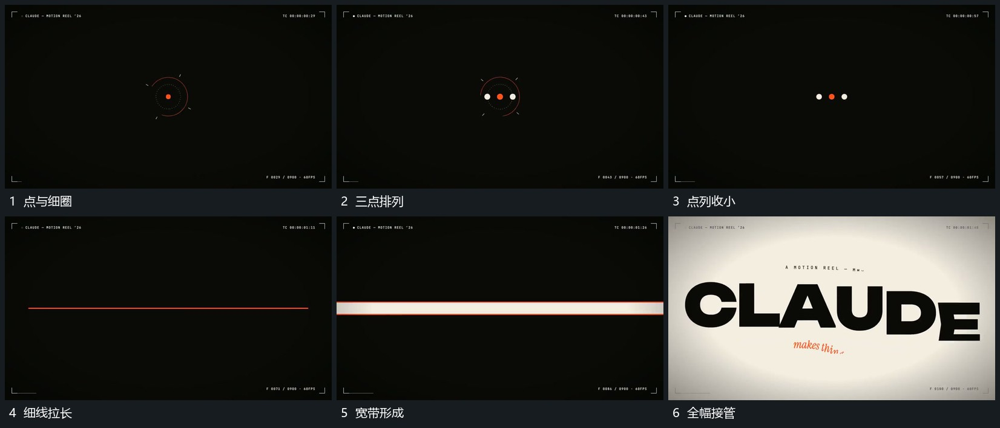

# 细线横向拉长再增加宽度覆盖全幅

## 运动指令

从小点与细圈收成横向点列，再连接为细线。线向两端延长至边界，随后增加厚度成为宽带，逐步覆盖全幅；下一主行在覆盖完成附近进入。

## 视频切片

[播放本机制的原片切片](m01.mp4)

覆盖分镜中“点与细圈”至“全幅接管”的连续过程，并保留邻近的前后衔接画面；原片中交叠发生的动作一并保留。

## 分镜过程

## 组合与调整

保持中心与水平轴；厚度增长接在长度展开之后，不同刻扩成满屏矩形。
