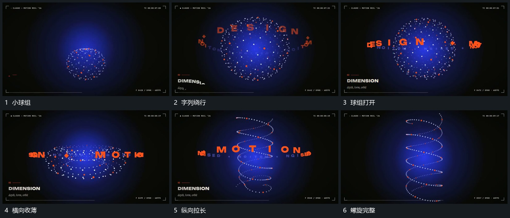

# 球状点组打开中心拉成长螺旋字列围轴绕行

## 运动指令

球状点组先围自身轴转向，字列在其外围绕行。中间点逐渐向周边移开，形成较空的中心，再沿纵向拉开多层点列，使上下接成螺旋。字列继续围共同轴经过，最后逐步退弱，只留螺旋。

## 视频切片

[播放本机制的原片切片](m04.mp4)

覆盖分镜中“小球组”至“螺旋完整”的连续过程，并保留邻近的前后衔接画面；原片中交叠发生的动作一并保留。

## 分镜过程

## 组合与调整

可只用球到环或环到螺旋；轴与点组身份连续，不把独立图形串成硬切。
