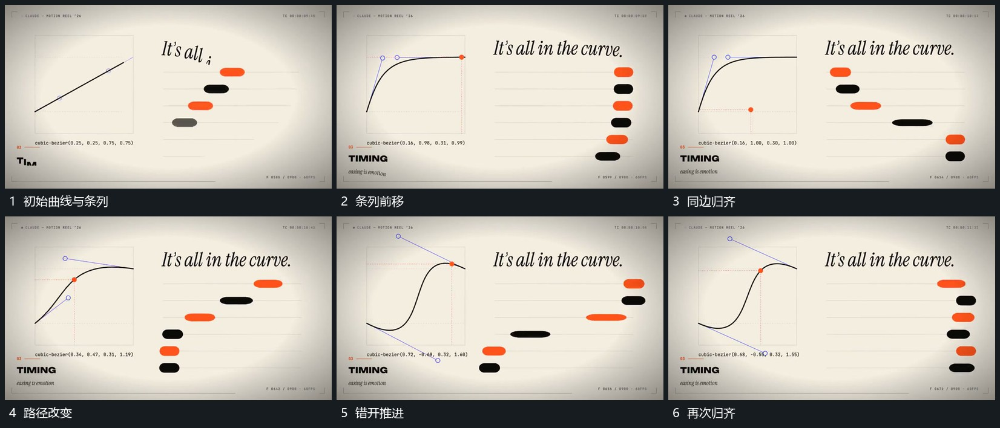

# 曲线标点沿路径移动多排短条错开横移并归齐

## 运动指令

左侧标点沿当前曲线移动，右侧多排短条同时横移，但各排起步和途中位移不同。经过中形成错位，最后停到共同竖向边界；更换曲线路径后重复，短条仍保留原排位。

## 视频切片

[播放本机制的原片切片](m05.mp4)

覆盖分镜中“初始曲线与条列”至“再次归齐”的连续过程，并保留邻近的前后衔接画面；原片中交叠发生的动作一并保留。

## 分镜过程

## 组合与调整

曲线形状与短条时序在新片重新设计，不把原曲线数字写成硬约束。
