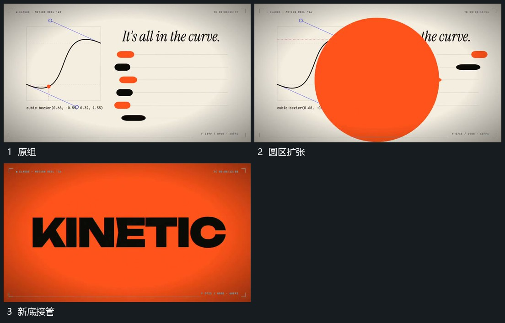

# 侧边圆区向外扩大覆盖并换底

## 运动指令

在侧边建立圆区，圆边向外扩大并横过原组，原组被覆盖区域逐步遮住。圆区越界后新底完整接管，下一主行接入，中心可沿覆盖方向继续。

## 视频切片

[播放本机制的原片切片](m06.mp4)

覆盖分镜中“原组”至“新底接管”的连续过程，并保留邻近的前后衔接画面；原片中交叠发生的动作一并保留。

## 分镜过程

## 组合与调整

可改变圆心位置，保持边界与接管一致；不让旧组提前整体消失。
