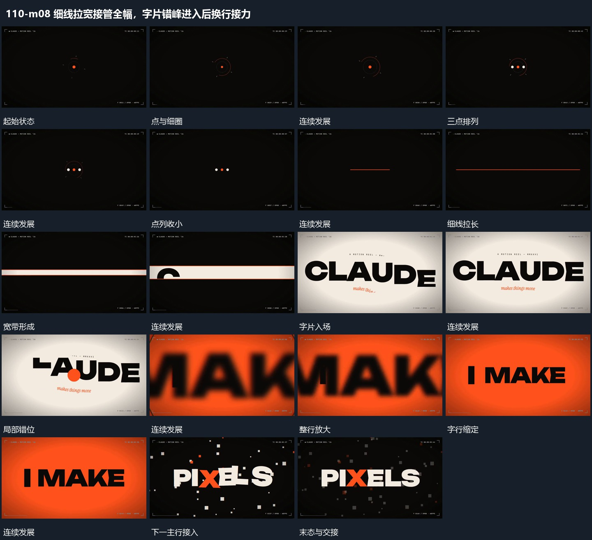

# 细线拉宽接管全幅，字片错峰进入后换行接力

## 运动指令

细线横向拉长并增加宽度覆盖全幅，字片在新底上错峰移入、转正缩定；随后局部放大与下一行接力完成字组变化。

1. **细线横向拉长再增加宽度覆盖全幅**

从小点与细圈收成横向点列，再连接为细线。线向两端延长至边界，随后增加厚度成为宽带，逐步覆盖全幅；下一主行在覆盖完成附近进入。

2. **字片错峰移入转正后整行缩定**

让字片错开进入，部分片带倾角或较大尺度，接近基线时逐步转正。字行完整后整组稍缩到稳定范围，内部间距随之收好；下一短行可从原位置接替，旧行先退让。

整段结束：完整字行停在稳定范围 保留必要落稳与交接，中间已建立的参照沿用到下一步骤。

## 视频切片

[播放本机制的原片切片](m08.mp4)

保留起始准备、连续发展和完成或明确交接；首尾按本段运动范围裁切，不拼接、不变速。相连的小动作合为同一完整段落。

## 分镜过程

## 组合与调整

细线横向拉长并增加宽度覆盖全幅，字片在新底上错峰移入、转正缩定；随后局部放大与下一行接力完成字组变化。 复用时可调整元素数量、幅度和相对节奏，保留上述进入、交叠与完成关系；不直接沿用原片题材或时长。

保持中心与水平轴；厚度增长接在长度展开之后，不同刻扩成满屏矩形。

字片可换几何片，不依赖原内容；入场和收势都落在同一基线。
