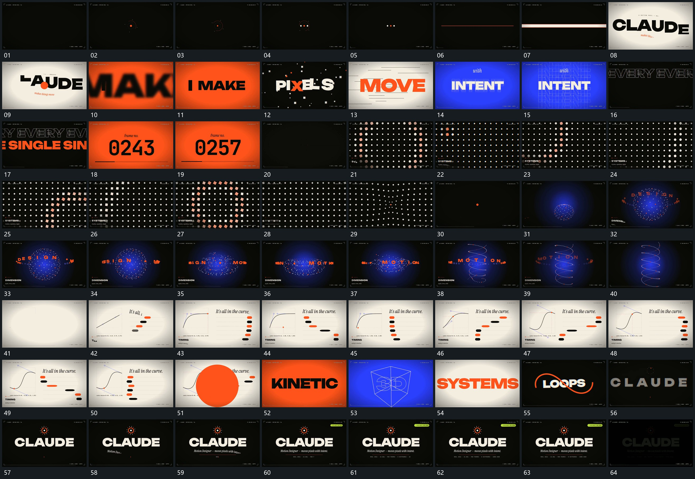

# 110｜原片运动总览

[观看完整原片](video.mp4)

## 运动总览

全片从小点与细圈开始，细线横向拉长再增加宽度覆盖全幅把细线横向拉长并增加宽度，接管全幅。字片错峰移入转正后整行缩定让字片错峰入场、转正和缩定，随后多次复用同类运动切换短行。

中段点与方片阵列的局部波动沿格位经过在格阵中让局部点与方片波动经过，球状点组打开中心拉成长螺旋字列围轴绕行把球状点组转为空心环和纵向螺旋，字列围其绕行。后段曲线标点沿路径移动多排短条错开横移并归齐让曲线局部标点沿线移动，旁侧多排短条按不同推进关系横移并回到共同边界；侧边圆区向外扩大覆盖并换底用圆区扩张完成换底。结尾复用字片错峰移入转正后整行缩定建立主行，再主行保持附属行逐次延长旁小片后接入逐项补下方短行和旁小片。

## 完整运动段落

以下按原片中的出现顺序引用。建立、内部发展及完成反馈放在同一段中；同时发生的局部动作与运镜写在同一份指令里。不同段之间可以是连续接管，也可以是直接切换，不能仅凭条目相邻认定可直接拼接。重复出现的同类运动采用一次连续代表范围，切片不以逐段无缝覆盖整片为目标。

1. [细线拉宽接管全幅，字片错峰进入后换行接力](mechanisms/m08.md)：细线横向拉长并增加宽度覆盖全幅，字片在新底上错峰移入、转正缩定；随后局部放大与下一行接力完成字组变化。

2. [点与方片阵列的局部波动沿格位经过](mechanisms/m03.md)：局部变形邻位接力

3. [球状点组打开中心拉成长螺旋字列围轴绕行](mechanisms/m04.md)：中心打开轴向伸展

4. [路径标点推进与短条错峰横移，圆区扩张交出画面](mechanisms/m09.md)：标点沿曲线推进，旁侧多排短条错峰横移并归齐；短条变化完成后侧边圆区放大覆盖，形成下一场的明确交接。

5. [主行保持附属行逐次延长旁小片后接入](mechanisms/m07.md)：主层保持附属层累积

切片保留起始准备、必要内部停顿和完成或明确交接；首尾省略无新发展的等待，持续运动不要求人为停住。以上基于真实源帧序列和重点边界核对，不等同于全片连续声画审片。

## 完整64宫格

