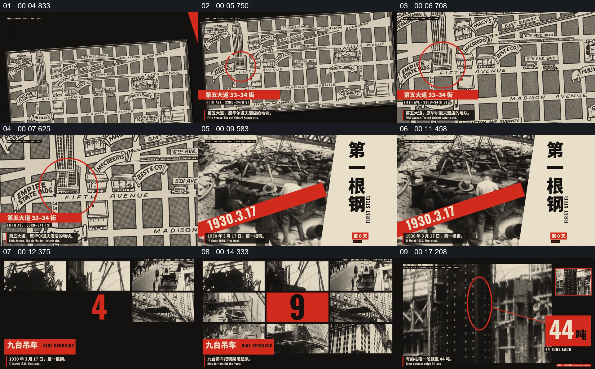

# 用地图定位工地，再让档案照片和数字展示施工规模

- 作品：案例 134（原批次 A01）《410Days档案影像与数字编排》；[公开来源](https://www.reclip.io/claude-opus-5-5-video-prompts/410-days-constructivist-archive-montage)。
- 原片范围：00:04.500—00:18.600，源时间，含起点、不含终点；[本地来源视频](../video.mp4)｜[本卡片段](c01.mp4)。
- 范围依据：由街区地图定位建筑，到工地档案、施工组图和数字标记；随后转入一份新的档案与工期说明。
- 观察方式与未确认范围：本轮查看整段来源的 64 帧时间序列及本卡九格，未独立完成连续原速观看；抽帧之间的连续运动、交叠、速度和停顿均待复核。本地视频有音轨，但本轮未完成听审。作品分析不等同于作者意图；迁移方法尚未在新项目实做。
- 原批次编号：A01-c01；正式编号：134-c01。

## 原画面具体怎样设计

米色与黑色版式切到街区地图，红圈标出建筑所在街区，底部保留地点文字。随后地图与施工工地的黑白照片相接，红色斜带上放置日期，右侧竖排大字标出建设阶段。

之后画面由多张高处施工照片组成，中央红色数字依次变化，左下角有一条红色说明。再往后单张楼体照片占主要画面，红圈、细线和一个数字卡指向局部。

## 为什么这样设计，好在哪里

作品分析：地图先回答在哪里，施工照片提供真实对象和环境，再用数字及标记突出某项规模；统一红色带把不同时期的资料组织进同一阅读空间。图片是否为真实档案，以及原片数字、日期和历史事件，均需独立核验。

## 完整照排指令

以[完整原片](../video.mp4)的 4.5–18.6 秒为准。画幅 1920×1080，源帧率 24/1。以下拍点为抽帧定位，位置按画幅百分比取近似值。

### 源时刻照排

- 4.5–约 9 秒，暖灰地图【街区底图】接过米黑字版，细红圆持续套在【建筑地块】，底左红底白字【地点文字】，底缘小白【出处行】。推进时以同一地块为锚，并由图面交到【工地档案照】。
- 约 9–12 秒，工地黑白照占左中，米白窄列在右放竖组黑粗【建设阶段】，红色日期斜带从左下跨过照片，白字【开工日期】保留倾角。暗底时阶段文字和红线优先可读。
- 约 12–15.5 秒，深底按网格逐一补【施工照片组】，中心留黑格排大号红【阶段计数】，末值可反为红底黑字。底左红色【施工注记】与小白出处行同屏，图片继续可辨。
- 约 15.5–18.6 秒，从斜置工地图转至单幅【楼体档案照】，红圈与细线指向楼体局部、接小窗和右下红底【局部数字卡】。保留楼体和数字的同屏结果，到 18.6 秒切出。

### 用料与取用

【街区底图】【建筑地块】【工地档案照】【施工照片组】【楼体档案照】须可证明属于同一建筑和对应时间阶段，供档案名称、日期、馆藏编号／原页链接；地图定位与照片中可观察位置一致，局部窗来自楼体同处。图片可静置或单次运镜，地图约 4.5–9 秒保持地块坐标，楼体与局部约 15.5–18.6 秒共同保持到切出，不循环或把照片运镜写成现场运动。【地点文字】【出处行】【建设阶段】【开工日期】【阶段计数】【施工注记】【局部数字卡】交可核对的原文、译文、数量口径、单位及证据位置，日期与阶段不得靠相近图推断。仅有地图可取约 4.5–9 秒地块定位；仅有单照与能够证实的数字可用约 15.5–18.6 秒。

### 验证状态

已对照原片近逐秒抽帧与卡稿，核对地图同一地块、日期斜带、照片逐格建立与楼体局部取证。细字、精确切点、原速听看及本卡试摆待核。
