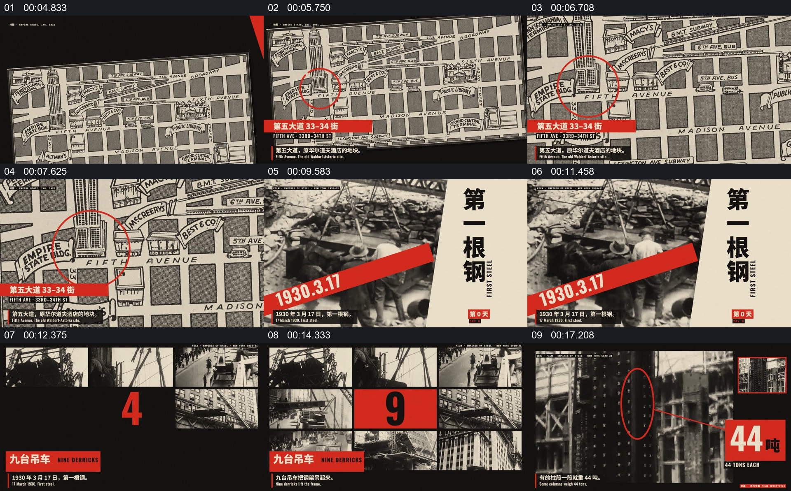

# 用地图定位工地，再让档案照片和数字展示施工规模

- 作品：案例 134（原批次 A01）《410Days档案影像与数字编排》；[公开来源](https://www.reclip.io/claude-opus-5-5-video-prompts/410-days-constructivist-archive-montage)。
- 原片范围：00:04.500—00:18.600，源时间，含起点、不含终点；[本地来源视频](../video.mp4)｜[本卡片段](c01.mp4)。
- 范围依据：由街区地图定位建筑，到工地档案、施工组图和数字标记；随后转入一份新的档案与工期说明。
- 观察方式与未确认范围：本轮查看整段来源的 64 帧时间序列及本卡九格，未独立完成连续原速观看；抽帧之间的连续运动、交叠、速度和停顿均待复核。本地视频有音轨，但本轮未完成听审。作品分析不等同于作者意图；迁移方法尚未在新项目实做。
- 原批次编号：A01-c01；正式编号：134-c01。

## 原画面具体怎样设计

米色与黑色版式切到街区地图，红圈标出建筑所在街区，底部保留地点文字。随后地图与施工工地的黑白照片相接，红色斜带上放置日期，右侧竖排大字标出建设阶段。

之后画面由多张高处施工照片组成，中央红色数字依次变化，左下角有一条红色说明。再往后单张楼体照片占主要画面，红圈、细线和一个数字卡指向局部。

## 为什么这样设计，好在哪里

作品分析：地图先回答在哪里，施工照片提供真实对象和环境，再用数字及标记突出某项规模；统一红色带把不同时期的资料组织进同一阅读空间。图片是否为真实档案，以及原片数字、日期和历史事件，均需独立核验。

## 可直接使用的创意指令

选一处有明确位置和可信档案的建设、事件或地点，先在地图上标明具体位置，再转向能辨认同一对象的照片或影像。涉及规模时把相应数据放在有来源的图片附近，用标线指向真正被解释的区域。地图、红带、组图可改造；保留位置、具体素材与数据的对应，不把示意图片伪装成该事件档案。
