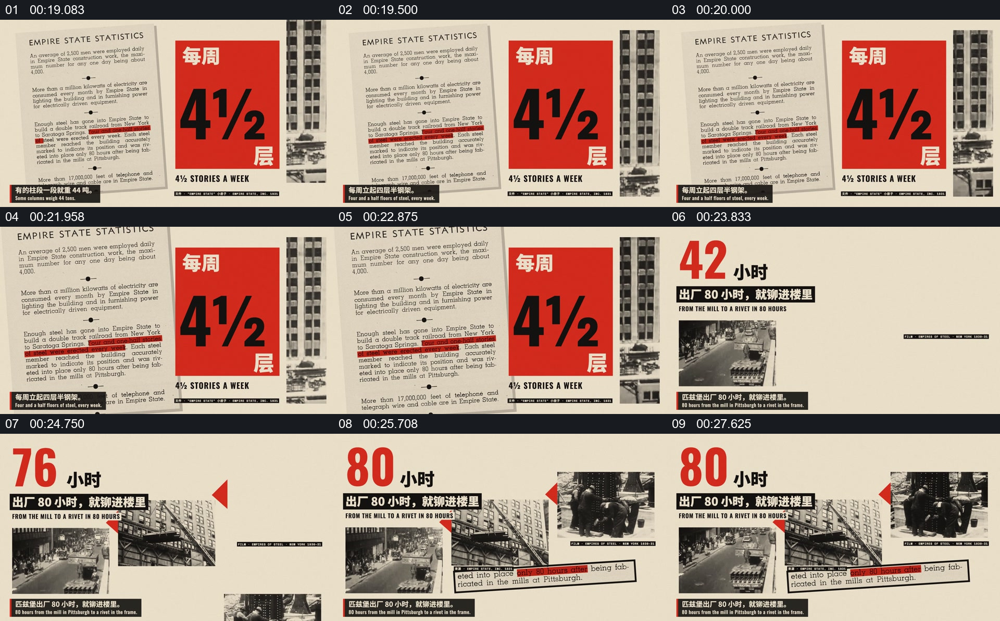

# 让档案原文、关键数字和照片共同解释工作进度

- 作品：案例 134（原批次 A01）《410Days档案影像与数字编排》；[公开来源](https://www.reclip.io/claude-opus-5-5-video-prompts/410-days-constructivist-archive-montage)。
- 原片范围：00:18.600—00:28.400，源时间，含起点、不含终点；[本地来源视频](../video.mp4)｜[本卡片段](c02.mp4)。
- 范围依据：从统计文档和每周楼层数据，到多张照片与工时数字并列；随后进入工人人数的新主题。
- 观察方式与未确认范围：本轮查看整段来源的 64 帧时间序列及本卡九格，未独立完成连续原速观看；抽帧之间的连续运动、交叠、速度和停顿均待复核。本地视频有音轨，但本轮未完成听审。作品分析不等同于作者意图；迁移方法尚未在新项目实做。
- 原批次编号：A01-c02；正式编号：134-c02。

## 原画面具体怎样设计

米色底左侧是一页英文统计文档，其中部分行被红色线条标出；右侧是一块醒目的竖向数字卡，写有每周约四层半。文档和数字并置，使原文及提炼后的数字同时可见。

随后版面转为多张施工照片的拼贴，左上大号红色数字变化并以“小时”为单位，旁边有黑底文字条。照片、数字和短说明共享同一个米色空间。

## 为什么这样设计，好在哪里

作品分析：文档提供被引用的视觉来源，大数字将读者注意力集中到一项信息；照片让数字与具体工作发生联系，而不是成为孤立计数。单位、来源文本和上下文应核对，画面本身不足以证明统计口径。

## 完整照排指令

原片为[案例 134](../video.mp4)，16∶9，1920×1080，24 帧/秒。卡内源时间为 18.600–28.400 秒。两版纸面演出至 28.000 秒，余下 0.400 秒是下一个黑底题签的入口。可以整段用，也可从第二版硬切的 23.250 秒开始，独立用到 28.000 秒。

下文 F 是**完整原片的帧号，从零开始**。位置按 640×360 缩尺描述，原尺寸乘三，矩形写成左、上、宽、高。坐标用来确定落点，素材在各自的窗里重新取景。只填写带黑括号的 `【名称】`，同名内容只填一次。各板的字号以画面中实际字面占幅为准。

### 用料

- 一页能读出两个指标来历的【档案页】，或来自同一可核对来源的纸页和摘句。请在原页上定位【甲原文】的跨行短语，在【乙引文】里定位第二个指标的关键词。摘句保留前后文字，供末拍做两行剪报。附两者实际出处【文书出处】。
- 一段能裁成高窄条的【窄幅影像】及其中短闪的【窄窗字样】，三段分别可辨的横向过程影像【影像一】【影像二】【影像三】和【影像出处】。原片三个窗里是会动的黑白历史影像。可从共用素材池取景，三个视点需要能各自辨认，窄窗允许复用其中一个源段。
- 两套分别有依据的数值和文字。甲填【口径词】【数值甲】【单位甲】【甲小字】。乙填【数值乙】【单位乙】【乙黑条标题】【乙小字】。副行有独立字位。沿用左下双语字幕样式时，填【字幕组】。带出后一场时填【下段题签】和【下段出处】。

### 第一版 · 纸面原句、红色数板、窄长影像

**18.600–18.792 秒，F446–450。** 入口已经有纸。用微颗粒暖米色铺满画面，原片空纸约 #E8DDC7，印墨近黑，强调红约 #D02A1D。左边是印着密排正文的【档案页】，左上约 (30,28)，右上约 (296,9)，右下约 (317,322)。纸比背景暗一档，右边及下沿露出细投影。标题一行较疏，正文多段，段间可见细横线与小圆点。左下约 (19,317) 叠【字幕组】，黑底约高 35、极细红色左边，中大下小两行浅字。上行字面高约 13–14，下行约 8，同贴左边，宽跟文字走。右下 (335,331) 已有一根约 200×9 的黑色【文书出处】条。右边上半部先留空。

**18.792–19.000 秒，F451–456。** 一个竖红数板从右横移，左边依次经过 x451、359，在 F453 落到 (336,40,200,246)。板内跟着一起进。左上是粗白【口径词】，约 70×35；中偏下是一整块紧凑粗黑【数值甲】，字面约 164×100，左右只留窄边。原字把 4 与斜线两侧上小、下大的分数组成一团。换成整数时，让两位紧挨着占回这团字的宽和高；【单位甲】用白色粗字贴右下，约 41×39。板下紧接一行黑色窄粗体【甲小字】，与板左边齐，字号远小于主数。更下方是先前已在的出处黑条。数板到位就保持这个大小和位置。

**19.042–19.375 秒，F457–465。** 最右边的【窄幅影像】从画顶向下进，F457 只见到 y201，F458 到 y313，F459 落稳在 (550,20,77,320)。裁到这么窄仍要有重复线条或可辨动作，影像用有层次的黑白。与此同时在左页【甲原文】的印字后面从左向右刷红，先刷上一行的尾词，接刷下一行的开头。两条各贴自己的字高、沿纸页的倾斜走，字墨压在红色上，前后文仍可读。原片 F457 只刷到首行一部分，F458 已跨行，F461 第二笔仍在长，F465 左右两处收齐。这里的强调必须落在纸上实际出现该短语的位置。

**19.417–23.250 秒，F466–557。** 红板、板下小字、来源条和窄窗外框停在原位。左纸围绕纸面中部缓慢推近到约 1.2 倍，标题逼近并略超出画顶，右下纸缘走到数板后面，两行红笔与正文同步放大。窄窗里素材继续播放，原片在 F477–478、F510–511、F543 极短地闪过黑底放大的浅色【窄窗字样】，随即回到影像，窄窗边界不动。左下字幕从入场前的句尾换成与甲指标对应的新句，约 F465–466 短空，F467 起读新句，F544 左右退尽。最后保留资料、红板与窄窗到 F557，整版下一帧硬切。

### 第二版 · 一个计数器，三幅逐级升高的过程影像

**23.250–23.667 秒，F558–568。** 同色纸面硬切干净，数板和档案页同时退出。左上从 (24,25) 起排窄厚的红色计数，字面高约 75；黑色粗体【单位乙】起于 x128，字面约从 y72 到 y102，高 31，约为红数高度的四成，两者底齐。原单位两个字约宽 65。新单位只有一个字时按同一字高自然收窄，右边留白。保留两位数字宽的读数区。由 0 逐渐减速计到【数值乙】。此刻右方 (455,207) 已有 164×9 左右的黑底浅字【影像出处】。最先让【影像一】从画面下缘快速升进 (23,180,187,127)，F559 第一幅可见画面已露出明显一截，上边在 y260，F560 到 y196，F561 到 y180。F565 左侧滑入一行粗浅字黑底【乙黑条标题】和紧贴下边的窄黑字【乙小字】，F567 稳在 (19,114)，原标题黑条约 266×32，副行的字面在 y152，高约 11，印在独立的暖纸色承托上。承托从 x19 到约 x234、下沿在 y165；它会盖住第一枚红三角的一部分。英文填得较短时，保留这段承托，让黑条主句与紧凑副行前后有别。F567–568 左下另起本拍的【字幕组】。黑条、角落字幕和右方细来源签是三个独立位置。

**23.708–24.167 秒，F569–580。** 第一窗继续播放。F574 在下一窗左边先亮出一个朝左的实心红三角，尖端约 (203,169)，右底边从 (234,141) 到 (234,197)。主标题与副行暖纸承托盖住三角上部。F576 画面下缘仍是空纸，F577 【影像二】首次可见，上边已到 y206，F578 到约 y142，F579 落到 (227,126,187,127)。第一、二窗横向隔约 17，第二窗顶比第一窗高 54。照片的左边压住三角底边，只露出指向上一幅的红尖。黑色标题条仍在上层，盖过第二幅的左上角，副行贴在它下方。

**24.208–25.167 秒，F581–604。** 两个已到位的窗继续播放。F592 第二个朝左红三角先出现，尖端在 (407,115)，右底边从 (437,87) 到 (437,143)。F594 第三段【影像三】从底边露出，上边在 y308，F595 到 y154，F596 到 y89，F597 落在 (430,73,187,127)。右图与中图再隔约 16，再高 53。图三的左缘压住第二个红三角，原已在画面的【影像出处】此时恰好成为它下沿的小签。三个窗同样大，顺序是**左下、中腰、右上**；每次新窗到来，旧窗留在原位并继续动。

计数与组图同时进行。用【数值乙】替换终值，按原片进度取整数。原终值为 80，F558、561、569、574、579、592、597、604 分别显示 0、3、33、47、58、75、78、80。前几步快，接近终值时慢；F604 起固定。黑条标题、旁句和引文写经核准的终值，计数过程中闪过的整数只属于动效。

**25.208–28.000 秒，F605–671。** 数字到位后才送【乙引文】。剪报左边在 F606 首次从右端 x630 露线，F607 到 x369，F608 到 x257，F609 到 x230。落稳时纸条左上约 (230,259)、右上 (580,242)，向右端抬高约 17，宽 350、高 42 左右。粗黑细长外框包着两行原文，左上沿叠更小的黑底【文书出处】签。条带压在中窗下缘，接近左窗右下角，上方的第三窗和两个红尖依然看得见。F611 才在引文第一行的数值短语后刷红，F617 已接近满宽，F618 收住，前后字仍有纸底。三段影像继续在各自窗里动，计数、单元文字、两行黑条字组、图与剪报同场保持，左下双语字幕约 F670 淡出。F671 仍见完整图组。

**28.000–28.400 秒，F672–681，邻场入口。** 纸面和三图硬切成近黑底，小号【下段出处】靠左。长米色【下段题签】从左边冲入，纸带约 440×55，右端比左端高 30。它的右边沿在 F672、673、674、675 分别到 x4、281、420、466，F676 落稳。此时左上角 (30,111)、右上角 (469,80)，中间叠浅灰内衬，深色细字疏排成一行。黑底上的【下段出处】约 (40,209)，F677 在 (19,317) 开始淡入下段双语字幕，F678 已明显，F679 读清。若下一场不采用，只用到 F672 切前。

### 交给填料作者

把文件、能用的源区间、窗内取景、准确文字和原文位置填在对应名称上。用暖灰黑白处理实景，纸底、黑字、底反白、强调色之间保持原有反差。中文变短时先调整字距或相近字款，维持该组字的重量和边界。若文书没有可指认的原句，档案强调和末拍剪报要补来源；若只有两份可辨的横向材料，三窗累积尚缺一窗。

交件时对照 F459 的跨行红笔、F574 的先行红尖、F594 的第三窗刚入而前两窗仍播放、F609 已落板但未刷红、F617 终值与三窗及局部红笔同在。三张已排好的末帧图只能核对占位，还要用连续片核对这些先后关系。

### 连续用料与局部采用

- 【窄幅影像】自 19.042 秒开始从上缘进入，除三次【窄窗字样】短闪外，持续到 23.250 秒硬切。准备约 4.21 秒可用动态素材。若动作仅承担气氛，可以循环平稳的非事件性运动，接缝放在黑底短闪内。若动作本身被引用，用连续视频。
- 【影像一】【影像二】【影像三】分别从 F559、F577、F594 首次露面，各自一直播放到 F672 切前，按 24 帧/秒分别至少备 113、95、78 帧。三窗须能读作同一工作过程中的不同视角或阶段，且与【数值乙】指向的工作相符。若来源仅能说明类似过程，在【影像出处】明确标成示意。窗口累积期间保留各自的真实动作和时间进程，禁止用定格、照片运镜或动作重播代替。
- 若素材只满足甲指标与窄窗，可独立采用 18.600–23.250 秒，从纸面建立到第一版完整保持后切出。若只满足乙指标及三窗和引文，可独立采用 23.250–28.000 秒。单一新窗无法承担乙版的累积过程。
- 【文书出处】须提供题名、作者或机构、可打开的链接或档案号，以及对应页码、段落或表格行。【数值甲】【单位甲】和【数值乙】【单位乙】保留各自统计口径。换料时逐项核对原文、终值和单位。

### 验证状态

已有连续原片逐帧核对及换料试摆。试摆范围为源时钟 18.600–28.400 秒，包含两版纸面、三窗接力、斜引文与下一场题签。本次回填核对了索引、源时间与原片 SHA-256，样片沿用该轮成果。已核对原片与换料在 F459、F574／F577、F594、F609／F611、F617 和 F672 的对位。试摆附件已从库内清理。试摆关注画面，原片听审与跨画幅适配待验证。

