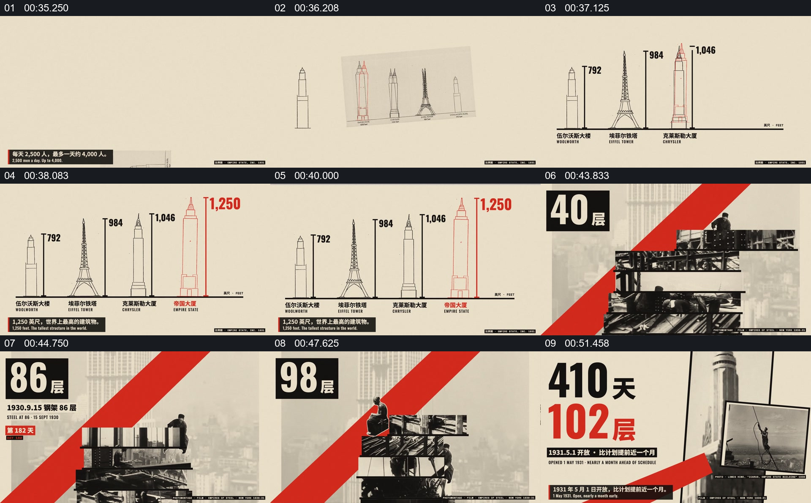

# 先比较建筑高度，再回到施工层数与完成结果

- 作品：案例 134（原批次 A01）《410Days档案影像与数字编排》；[公开来源](https://www.reclip.io/claude-opus-5-5-video-prompts/410-days-constructivist-archive-montage)。
- 原片范围：00:35.000—00:55.600，源时间，含起点、不含终点；[本地来源视频](../video.mp4)｜[本卡片段](c03.mp4)。
- 范围依据：从多座建筑高度并列，到主体建筑层数和工期结果；55 秒后进入署名与结束页。
- 观察方式与未确认范围：本轮查看整段来源的 64 帧时间序列及本卡九格，未独立完成连续原速观看；抽帧之间的连续运动、交叠、速度和停顿均待复核。本地视频有音轨，但本轮未完成听审。作品分析不等同于作者意图；迁移方法尚未在新项目实做。
- 原批次编号：A01-c03；正式编号：134-c03。

## 原画面具体怎样设计

米色背景上排列几座建筑的线描轮廓，每座旁边标有高度数字；最后一座用红色轮廓和红字强调，顶部出现关于高度的提示。多座建筑同处一张基准画面。

随后画面转为施工高处的黑白人物与钢架，红色斜带穿过背景，左上角的层数由较小数字变为更高数字。结尾“410 天”和“102 层”同屏出现，旁边并列楼体和施工照片。

## 为什么这样设计，好在哪里

作品分析：先给其他建筑作为参照，高度数字才有相对尺度；之后回到工人和楼层，使统计对象与建设过程重新联系。最后将工期和层数放在一起形成结果。原片线描是否严格按比例绘制及数字真实性均需额外核对。

## 完整照排指令

以[完整原片](../video.mp4)的 35–55.6 秒为准。画幅 1920×1080，源帧率 24/1。以下拍点为抽帧定位，位置按画幅百分比取近似值。

### 源时刻照排

- 35–约 43 秒，米色纸底，黑色【建筑轮廓组】沿同一水平线依次排开，各顶端用细竖标和黑字写【高度数值】，底下配【建筑名称】。最后一座用红线描及红色数值，顶部红底白字【比较结论】最后出现。
- 约 43–49 秒，切黑白【高处施工照】，红色斜带从左下穿向右上。施工平台或人物保留在前层，左上黑底粗体【楼层计数】分级更换，白色数值至最后一档转红，下方另放细字号【阶段日期】。
- 约 49–55.6 秒，完成态以浅底左列两行大字【工期数字】【最终层数】定格，上黑下红；右边并列竖长【完工楼体】和倾斜的【施工档案小图】，红色斜带维持方向。数值与图均留至本卡切出。

### 用料与取用

【建筑轮廓组】【高度数值】【建筑名称】【比较结论】取同一比较年份、同一高度定义和单位，交能核对到表项的来源，轮廓按共同基线和尺度绘制。【高处施工照】【施工档案小图】【完工楼体】须能核对同一建筑并区分施工与完工，附馆藏或出版出处、拍摄日期及允许裁切范围。楼体身份从红色比较项延续到片尾，【楼层计数】【阶段日期】【工期数字】【最终层数】要对应同一工程记录，注明工期起止及层数计算。照片可静置或单次运镜，阶段递进不得循环或靠推拉假造现场动作。只具高度数据取 35–约 43 秒；若有档案与已核准的工期层数，可独立用约 49–55.6 秒。

### 验证状态

已对照原片等距抽帧与卡稿，核对共用基线、红斜带、楼层递进和两数字收束。来源原数字、准确切点、原速听看与本卡换料待核。
