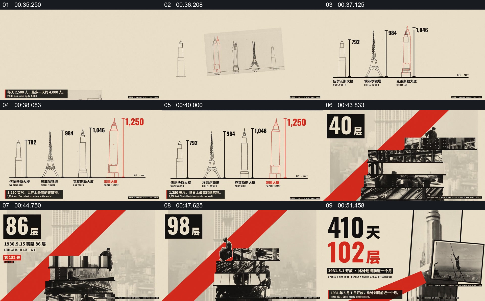

# 先比较建筑高度，再回到施工层数与完成结果

- 作品：案例 134（原批次 A01）《410Days档案影像与数字编排》；[公开来源](https://www.reclip.io/claude-opus-5-5-video-prompts/410-days-constructivist-archive-montage)。
- 原片范围：00:35.000—00:55.600，源时间，含起点、不含终点；[本地来源视频](../video.mp4)｜[本卡片段](c03.mp4)。
- 范围依据：从多座建筑高度并列，到主体建筑层数和工期结果；55 秒后进入署名与结束页。
- 观察方式与未确认范围：本轮查看整段来源的 64 帧时间序列及本卡九格，未独立完成连续原速观看；抽帧之间的连续运动、交叠、速度和停顿均待复核。本地视频有音轨，但本轮未完成听审。作品分析不等同于作者意图；迁移方法尚未在新项目实做。
- 原批次编号：A01-c03；正式编号：134-c03。

## 原画面具体怎样设计

米色背景上排列几座建筑的线描轮廓，每座旁边标有高度数字；最后一座用红色轮廓和红字强调，顶部出现关于高度的提示。多座建筑同处一张基准画面。

随后画面转为施工高处的黑白人物与钢架，红色斜带穿过背景，左上角的层数由较小数字变为更高数字。结尾“410 天”和“102 层”同屏出现，旁边并列楼体和施工照片。

## 为什么这样设计，好在哪里

作品分析：先给其他建筑作为参照，高度数字才有相对尺度；之后回到工人和楼层，使统计对象与建设过程重新联系。最后将工期和层数放在一起形成结果。原片线描是否严格按比例绘制及数字真实性均需额外核对。

## 可直接使用的创意指令

准备口径一致的主体与比较对象，先在共同基准上展示可辨认的轮廓及数值；然后回到主体的真实过程素材，用经过核实的阶段数字呈现变化。结尾同时保留主体身份和最重要的结果。色彩、线描和照片布局可以更换；保留比较基准、数值单位及过程与结果的关系，比例示意应明确标注。
