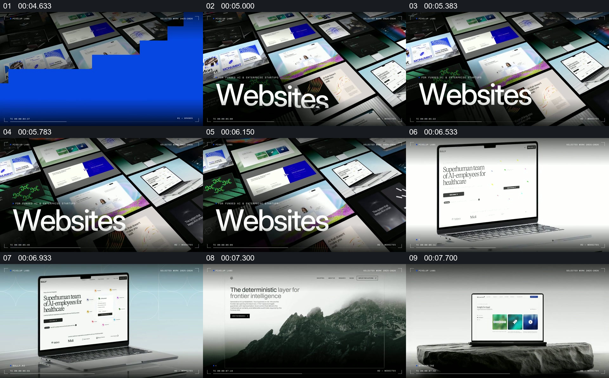

# 从网页作品墙选出单件，再展示设备中的页面

- 作品：案例 135（原批次 A02）《Pixelup影像文字与页面切换》；[公开来源](https://www.reclip.io/claude-opus-5-5-video-prompts/pixelup-labs-studio-showreel)。
- 原片范围：00:04.500—00:08.150，源时间，含起点、不含终点；[本地来源视频](../video.mp4)｜[本卡片段](c01.mp4)。
- 范围依据：从网页集合和分类标题到几幅独立设备与页面示例；之后切换到产品展示。
- 观察方式与未确认范围：本轮查看整段来源的 40 帧时间序列及本卡九格，未独立完成连续原速观看；抽帧之间的连续运动、交叠、速度和停顿均待复核。本地视频有音轨，但本轮未完成听审。作品分析不等同于作者意图；迁移方法尚未在新项目实做。
- 原批次编号：A02-c01；正式编号：135-c01。

## 原画面具体怎样设计

黑色空间中，许多网页截图组成倾斜的矩阵，大号“Websites”文字位于前景左下。随后整个集合画面切到一台笔记本电脑，屏幕内呈现具体网站，周围背景变为浅灰色。

之后出现另一张带山景的大幅网页和放在岩石上的笔记本网页；不同页面各自占据主要观看区域。

## 为什么这样设计，好在哪里

作品分析：集合先让观众知道展示对象是一组网页，单独设备画面则提供看清页面结构的机会。前景类别标题和多个不同的网站画面分别承担“是什么”和“具体长什么样”；不能从宣传画面推断各网站实际可访问或可操作。

## 可直接使用的创意指令

准备多份有可展示权限的页面，先以能区分各作品的缩略集合建立类别，再选择一件放入设备或足够大的浏览窗口，留出辨认标题、图片和布局的空间。可继续展示其他页面，但每次应让当前对象清楚；集合与单例的身份关系、实际页面内容应保持可核对。
