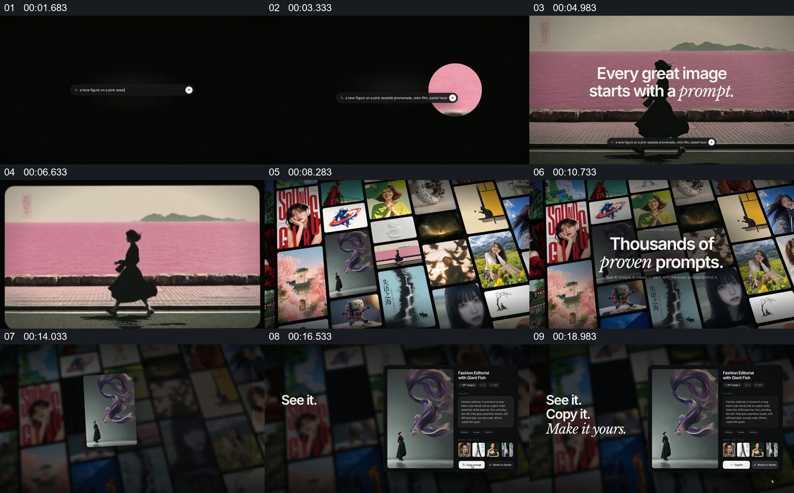

# 从一个生成画面扩展到图片墙，再回到单张详情

- 作品：案例 136（原批次 A03）《GenVizu图片墙与界面接力》；[公开来源](https://www.reclip.io/claude-opus-5-5-video-prompts/genvizu-product-launch)。
- 原片范围：00:00.000—00:20.000，源时间，含起点、不含终点；[本地来源视频](../video.mp4)｜[本卡片段](c01.mp4)。
- 范围依据：从提示输入及单幅图片建立，到大规模图片集合和一张作品的详情；之后转到另一项模型界面。
- 观察方式与未确认范围：本轮查看整段来源的 64 帧时间序列及本卡九格，未独立完成连续原速观看；抽帧之间的连续运动、交叠、速度和停顿均待复核。本地视频有音轨，但本轮未完成听审。作品分析不等同于作者意图；迁移方法尚未在新项目实做。
- 原批次编号：A03-c01；正式编号：136-c01。

## 原画面具体怎样设计

黑色背景中间有细长输入框，随后粉色场景与人物剪影占据主要画面，上面叠有说明文字。该图随后呈现在一个有边界的图片框内，周围开始出现其他大小不一的画面。

后续形成倾斜的多图墙，中央叠加一行关于提示素材的文字；图片墙变暗，某张作品的竖向预览与右侧详细信息在前景出现，左侧短句依次展示“See it. / Copy it. / Make it yours.”。

## 为什么这样设计，好在哪里

作品分析：先给一张完整结果，再展示候选集合，观众能把大量缩略图理解为同一类输出；暗化后景、放大一项详情则把注意力从数量引回可阅读的具体对象。界面与提示词的功能属于作品演示，不证明实际模型能力或版权状态。

## 可直接使用的创意指令

选择一张可辨认的结果作为入口，给它足够画面空间，再将它放进由其他独立作品组成的集合。需要说明如何选择或使用时，让集合退到背景，选中一项并与该项真实详情并排。类别、排列方式与文字均可更换；保留单项与集合之间的回认，以及所选作品与说明的一致性。
