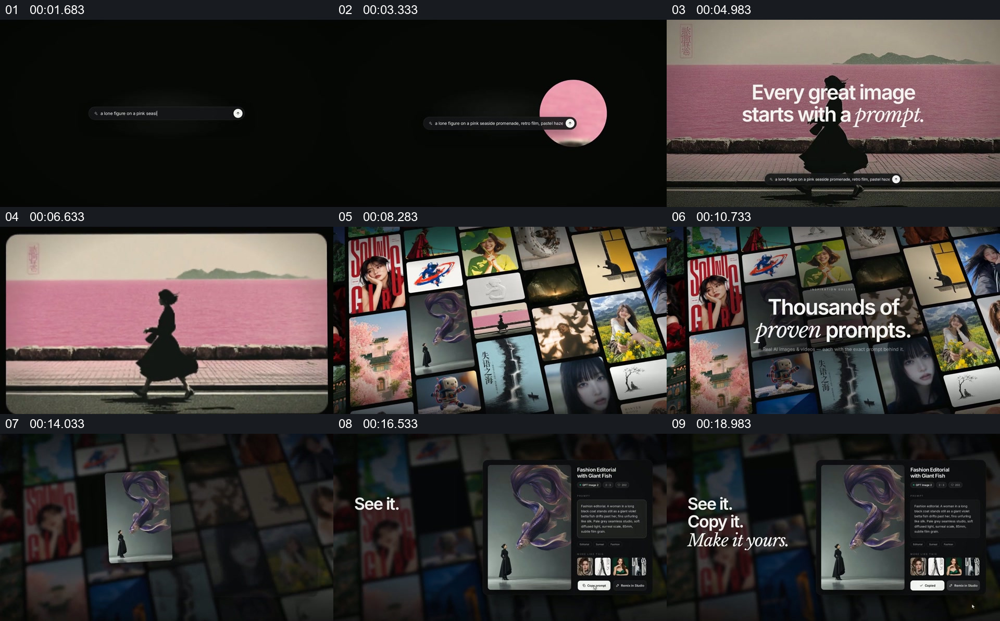

# 从一个生成画面扩展到图片墙，再回到单张详情

- 作品：案例 136（原批次 A03）《GenVizu图片墙与界面接力》；[公开来源](https://www.reclip.io/claude-opus-5-5-video-prompts/genvizu-product-launch)。
- 原片范围：00:00.000—00:20.000，源时间，含起点、不含终点；[本地来源视频](../video.mp4)｜[本卡片段](c01.mp4)。
- 范围依据：从提示输入及单幅图片建立，到大规模图片集合和一张作品的详情；之后转到另一项模型界面。
- 观察方式与未确认范围：本轮查看整段来源的 64 帧时间序列及本卡九格，未独立完成连续原速观看；抽帧之间的连续运动、交叠、速度和停顿均待复核。本地视频有音轨，但本轮未完成听审。作品分析不等同于作者意图；迁移方法尚未在新项目实做。
- 原批次编号：A03-c01；正式编号：136-c01。

## 原画面具体怎样设计

黑色背景中间有细长输入框，随后粉色场景与人物剪影占据主要画面，上面叠有说明文字。该图随后呈现在一个有边界的图片框内，周围开始出现其他大小不一的画面。

后续形成倾斜的多图墙，中央叠加一行关于提示素材的文字；图片墙变暗，某张作品的竖向预览与右侧详细信息在前景出现，左侧短句依次展示“See it. / Copy it. / Make it yours.”。

## 为什么这样设计，好在哪里

作品分析：先给一张完整结果，再展示候选集合，观众能把大量缩略图理解为同一类输出；暗化后景、放大一项详情则把注意力从数量引回可阅读的具体对象。界面与提示词的功能属于作品演示，不证明实际模型能力或版权状态。

## 完整照排指令

以[完整原片](../video.mp4)的 0–20 秒为准。画幅 1920×1080，源帧率 60/1。以下拍点为抽帧定位，位置按画幅百分比取近似值。

### 源时刻照排

- 0–约 4 秒，纯黑中央摆细长暗色圆角【提示输入框】，小字号【提示原文】左齐，白色圆形提交控件在右端；粉色圆面从右侧显形后交给宽幅首图。
- 约 4–7 秒，【首张作品】铺开，粉色地景与暗色人物分层。居中略偏左叠两行白色【开场主句】，关键词用斜体；底部细控件对齐安全区。
- 约 7–14 秒，同一首图缩入圆角格，周围渐补多张【图库作品】，镜头从单格拉至倾斜图墙。墙上保留图片差异，中央置白色【图库文案】，强调词斜排。
- 约 14–20 秒，压暗图库，前景并排放【选中预览】及深色【详情面板】，右栏小字【详情原文】与小缩略图。左侧大白字【步骤短句】分三拍出现，末行斜体。20 秒切出。

### 用料与取用

【提示输入框】【提示原文】与【首张作品】须可说明输入及结果关联；首图从约 4 秒建立、约 7 秒入墙并保持至约 14 秒图库压暗。动态窗口用同源连续片段、留足放大和入墙时长，不循环或定格；静态图可作圆角遮罩和一次缩放。【图库作品】交多种构图与足够边距，【选中预览】【详情面板】【详情原文】须对应图库内同一可辨作品及实际条目，交授权图和真实文案。【开场主句】【图库文案】【步骤短句】提供精简标题，涉及素材数量或功能能力须有可核对出处。仅有一份提示与成品时可取 0–约 7 秒；只有详情条目可用约 14–20 秒以静态详情入画。

### 验证状态

已对照原片等距抽帧与卡稿，核对输入到首图、首图入墙、图库变暗与详情前置。精确切点、原速听看及换料试摆待核。
